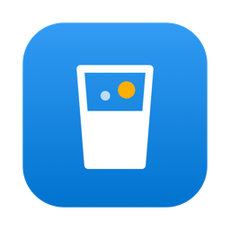
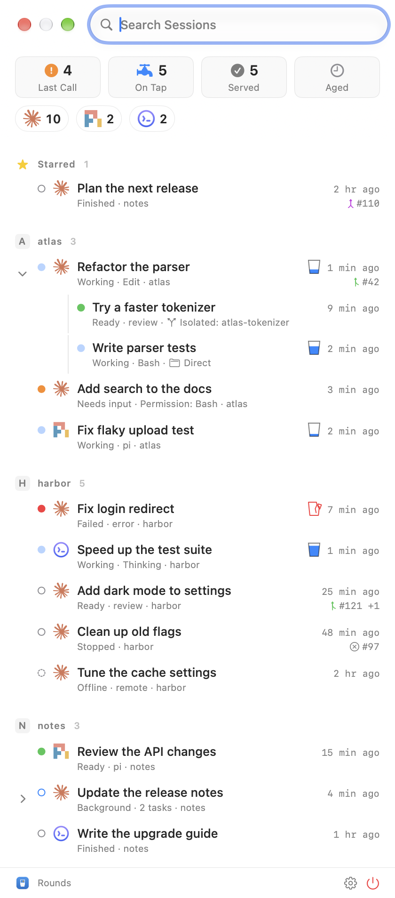

<p align="center"></p>

<h1 align="center">Rounds</h1>

<p align="center">Your agents work in parallel. You need to stay sober.</p>

<p align="center"><a href="https://rounds.henry.wang">Docs</a> · <a href="LICENSE">MIT License</a> · Made with <a href="https://henry.wang">Henry</a> by AI 🤖.</p>

Rounds is a native macOS app that shows the live state of your AI coding sessions from Claude Code, Codex and herdr in one list. A pill at the screen edge shows how many sessions run and turns orange when one needs you. Hover over the pill to open the session window, then press Return to go to a session.

The name is a round of drinks, one for each session. When nothing needs you, Rounds asks: "🍹 Another round?"



## Features

- **Pill at the screen edge:** blue with the running count while sessions run, green when an agent finished and its result waits for you, and orange or red when a session needs your input or failed (it peeks out until you look). Its count is always the Last Call count.
- **One list for every source:** Claude Code, Codex and herdr agents (pi and others), grouped by project. Child sessions show under their parent, as Direct (the same folder) or Isolated (a folder of their own).
- **Tiles:** Last Call (Your Turn), On Tap (Running), Served (Quiet) and Aged (Older). Each tile filters the list.
- **Live state from hooks:** Needs input, Failed, Working, Background, Ready, Finished, Stopped and Offline, with the tool or question as detail. Working rows show a small glass that fills and empties.
- **Marks:** Star, Mark as Done and Hide, with Undo.
- **Keyboard first:** a global shortcut, ↑ ↓ and Return, and ⌘1 to ⌘5 for the tiles.

## Requirements

- macOS 27 or later.
- To build from source: Xcode Command Line Tools (`xcode-select --install`). Xcode is not needed.
- At least one source: Claude Code in the Claude desktop app (the Code tab), Codex, or herdr. Rounds does not read Claude Code sessions started in a terminal, except inside herdr.

## Install

Download [Rounds.dmg](https://github.com/HenryQW/rounds/releases/latest/download/Rounds.dmg), or install it with Homebrew:

```sh
brew trust --tap henryqw/tap && brew install --cask henryqw/tap/rounds
```

Rounds has no Developer ID signature, so macOS blocks a downloaded copy at first. Run `xattr -dr com.apple.quarantine /Applications/Rounds.app`, or click Open Anyway in System Settings > Privacy & Security.

To build from source:

```sh
git clone https://github.com/HenryQW/rounds.git
cd rounds
scripts/bundle.sh --install
open /Applications/Rounds.app
```

Then open Settings (right-click the pill) > Sources and click **Install Hooks…** for Claude Code and Codex. Each install shows every entry before it writes, and keeps a backup of the file it changes. A source without hooks is off.

## Development

| Task | Command |
|---|---|
| Run the tests | `scripts/test.sh` |
| Build, sign and install the app | `scripts/bundle.sh --install` |
| Make the disk image | `scripts/dmg.sh` |
| Make a release | Push a tag `v<VERSION>`; see `website/docs/release.md` |
| Render the app icon | `swift scripts/make-icon.swift` |
| Take the docs screenshots (demo data) | `scripts/screenshots.sh` |
| Run the docs site | `cd website && pnpm install && pnpm dev` |

The version is in `VERSION`. The design is in [DESIGN.md](DESIGN.md), the words in [GLOSSARY.md](GLOSSARY.md), and the full behaviour in [docs/spec.md](docs/spec.md). The app build (`Sources/`) does not include the docs site (`website/`).

## Privacy

Rounds reads local session files and herdr's local socket. It sends nothing to any server. **Report a Bug** in Settings opens a GitHub issue page with the versions filled in, and you choose whether to send it.

## License

[MIT](LICENSE) © 2026 Henry Wang. The Claude, Codex, pi and herdr icons belong to their owners. Rounds shows them only to name each source.
