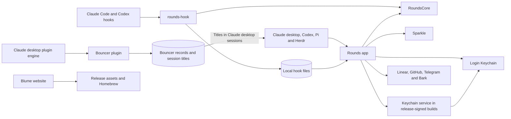

# Architecture and ownership

Use this map to find the owner of a change. [The specification](spec.md) defines app behavior. [DESIGN.md](../DESIGN.md) defines the native design, and [GLOSSARY.md](../GLOSSARY.md) defines the product terms. The [Bouncer decision log](bouncer-mode/decisions.md) records the owner's workflow decisions.

## Dependency map

| Boundary | Entry point and contract | Checks |
| --- | --- | --- |
| Native app | [`Package.swift`](../Package.swift) declares `Rounds`, `RoundsCore` and `rounds-hook`. `RoundsCore` owns model types and rules, with platform libraries and no package dependencies. | `scripts/test.sh --no-parallel`; `scripts/check-architecture.sh` checks the manifest and the core's active macOS imports in Debug and Release. |
| App bundle | [`scripts/bundle.sh`](../scripts/bundle.sh) assembles the Swift executables, Pi extension and Sparkle. Release-signed builds also include the Keychain service. Beta and Stable publish distinct appcasts. | [Release verification](../website/docs/release.md) checks bundle identity, update metadata and signatures. |
| Claude desktop Bouncer | [Plugin manifest](../plugins/bouncer/.claude-plugin/plugin.json), `hooks/register.tsx` and `skills/bouncer/` use the Claude plugin engine and local commands. | [Bouncer test instructions](../plugins/bouncer/README.md#develop-and-test) cover script fixtures and engine tests. |
| Experimental Pi Bouncer | [Claim loop](bouncer-mode/pi-loop.md) runs through Pi extensions and scripts in the `henry` skill. GitHub issues and live process state own its work. | [Live test report](bouncer-mode/pi-loop-test.md) records its first run. |
| Website | [`website/package.json`](../website/package.json) pins the Blume build. `website/blume.config.ts` and `website/theme.css` own web presentation. The install page and script reference the published release. | `pnpm validate` and `pnpm build` from `website/`. |

## State and rule owners

| Concept | Authority | Consumers and constraints |
| --- | --- | --- |
| Agent observations | `DesktopSession`, `HookLine`, `Codex`, `Pi`, `Herdr` and `TranscriptTail` in `Sources/RoundsCore` parse the [source contracts](spec.md#2-data-sources). `AppModel` owns watches, source caches and refresh timing. | Desktop session data, Codex's SQLite database and agent logs belong to their source apps. The Rounds hook and Pi extension write local state for Rounds. |
| Displayed session and explanation | `SessionRow` owns row identity. `AppModel` owns a `SessionSnapshot` per source. The source classifier decides the state. `StateInput` replays that decision. | `Grouping` applies marks and parent-child rules. Diagnostic inputs leave with their rows. `WrongStateReport` writes a redacted replay fixture. |
| Project and organization | `Projects.swift` owns display grouping. `OrganizationBoundary` verifies a folder and its worktree link for outbound permission. | Project grouping can use a best-effort path. Organization permission uses the real path and requires a Git backlink for worktrees that inherit a rule from the main checkout. |
| Marks, filters and preferences | `AppModel` owns session marks and filter state. The preferences used by app modules live in the app's `UserDefaults` store. | The current UI paths read and write these values. `DESIGN.md` defines color and interaction semantics. |
| Ticket discovery and cache | `TicketData` and `Tickets` own local lookup rules and ticket values. `TicketStore` owns cache lifetime, batching and service backoff. | The cache is `tickets.json` in Rounds' application support folder. A service error can retain an older entry. |
| Alerts and history | `PushQueue` owns remote event identity. `PushStore` checks eligibility, sends and plays local sounds. `WaitTracker` owns wait intervals and `HistoryStore` appends them. | A remote alert sends once per channel, with no retry. History records completed waits in local daily files. |
| Credentials and outbound permission | `OrganizationPolicyStore` owns the local rules, permissions and lease. `OutboundSession` refuses redirects and cookies. The Keychain owns Linear and push credentials. The GitHub CLI owns GitHub login. | `TicketStore` and `PushStore` check the current destination and session before a send. Their status checks use no session data. |
| Errors and logs | Loaders own input errors. `AppModel` surfaces persistent source failures. Each remote store reports its service's status and timing. | [Data source rules](spec.md#2-data-sources) define the retry and privacy behavior per operation. Logs omit credentials. |
| Bouncer configuration | `userConfig` in the plugin manifest owns defaults. The hook reads engine options. `bouncer_config.py` owns the scripts' stored option lookup. | Title and ledger commands retain their documented environment overrides. `bouncer-data` owns the script-side data path and migration. |
| Bouncer workflow and data | [The skill](../plugins/bouncer/skills/bouncer/SKILL.md) routes requests. Its commands own the queue, questions, grants, decisions and ledger operations. | Session titles identify the pool. Existing records and title formats remain readable across plugin updates. |
| Build and release | `Package.swift`, `Package.resolved`, `VERSION`, `CHANGELOG.md` and `website/package.json` own their respective dependency, version and release inputs. | Pull requests run native tests and Bouncer script fixtures. Signing and publishing run in Beta and release workflows. |

## Decisions in this round

| Decision | Reason | Verification |
| --- | --- | --- |
| Store rows and classifier inputs together by source. | A failed or empty refresh had cleared rows but could keep old inputs. Source lookup and `SessionRow.id` now identify the input. | `SessionSnapshotTests` checks refresh, removal, optional input and row-based equality. |
| Share only stored Bouncer option resolution. | The three script readers duplicated settings and manifest lookup. Option-specific overrides and blank-value rules have different callers. | Bouncer fixtures exercise the title, assignment and ledger paths together. |
| Share literal ticket lookup for the queue, grants and questions. | The queue and grants treated ticket keys as regular expressions and could read or replace entries for another key. The three commands use `bouncer-ticket-rows.sh` and keep their own ordering and closure rules. | Bouncer fixtures check distinct keys, position of replacements and decision-based question closure. |
| Route idle Bartenders by the complete repository name and check the active cap first. | The route had used the final word of current idle titles. It could also assign work at the cap or omit a legacy multiword status from the count. | Route fixtures check full names, suffix collisions, legacy titles, and assignment at the cap. |
| Check Swift target declarations and imports before pull request tests. | Target declarations alone permit platform framework imports. A Swift Package Manager flag also accepted a transitive import in a negative probe. | `scripts/check-architecture.sh` scans the source list that Swift Package Manager resolves. Fixtures cover conditional imports, excluded files and target dependencies. |
| Use the same native test entry point locally and in workflows. | Command Line Tools need a macro plugin path. Xcode uses its toolchain directly. Both need serial tests for the existing timing cases. | The pull request workflow uses the same entry point as Beta and Stable. |

## Open work

| Area | Evidence and next scoped task | Condition |
| --- | --- | --- |
| Bouncer title grammar | The title writer, `bouncer-route`, `hooks/pool.ts` and `DesktopSession` consume overlapping parts. Current idle titles carry the complete repository name. A name such as `[Dev] repo` is ambiguous with a task whose key is `Idle`; the route counts it as busy. Bouncer activation still requires a single-word name. | Confirm which legacy titles active installations still produce before changing the format. Compare shared fixtures with a shared runtime and verify desktop engine support. |
| Bouncer path and ownership | The hook derives the repository from the session working directory. `bouncer-data` uses the main checkout and can move older records. The hook also owns the per-repository claim file. | Probe the desktop engine with alternate paths and simultaneous sessions before changing ownership or migration. |
| Bouncer persisted edits | Ticket matching is shared. The commands still write separate files, and decision edits update several files in sequence. | Test concurrent writers and recovery before changing the write mechanism. Preserve queue and question ordering. |
| Source refresh coordination | `AppModel` owns source timing, caches and composition. `TicketStore` calls back into regrouping, then receives the list for future lookups. | Trace which callbacks can change rows during regrouping before moving source loading or changing store lifetimes. |
| Settings and design | The settings UI uses shared row helpers. Some controls and stores own their own preference reads and writes. | Inventory a setting's full read and write path when it changes. Keep its default and persistence key with its owner. Choose mockups before a design change. |
| Worktree resolution | Display grouping and outbound authorization both inspect `.git` pointers, with different verification rules. | Keep both policies. Share only byte parsing if fixtures preserve the authorization boundary and display fallback. |
| Additional automated checks | The macOS pull request job covers the native package and script fixtures. Plugin engine tests and website builds have separate local commands. | Add checks when their runtime inputs are available on a suitable runner and failures can identify the responsible module. |
