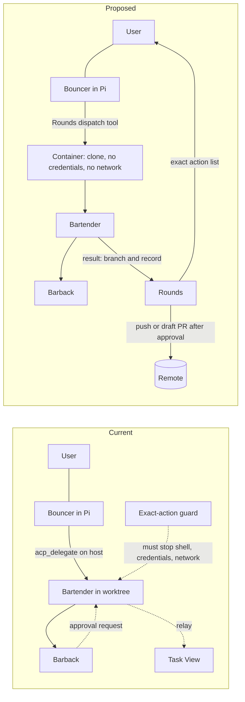

# Bouncer design review

Goal: the user gives goals, makes decisions and reviews results. The design must remove every other task from the user and keep the build small. This review checks the Bouncer, Bartender and Barback design against that goal. Nothing here is accepted until the user decides.

## Main finding

The current design lets agents try any protected action, then tries to stop the action before it runs. That needs an exact-action guard on an open shell, a relay for each request, and an Interrupted state. The [feasibility check](feasibility-check.md) has 24 checks and still cannot prove this boundary.

The proposal turns it around: **agents produce, Rounds publishes.** Agents run in containers without credentials and without network, except the model relay through Rounds. They cannot do a protected action. Rounds does a closed list of actions on the host, and only after the user approves the exact list. Version one has two actions: push a branch and open a draft pull request.

## Current and proposed flow

## Changes

| Area | Current design | Cost | Proposal |
|---|---|---|---|
| Protected actions | Agents can try any action; a guard must stop it | Open-ended boundary that is not verified | Agents cannot act outside the container. Rounds runs a closed action list after approval. |
| Approval relay | A Barback asks its Bartender, the Bartender reviews, the runtime relays to the Task View | Three steps and a live channel for each request | The approval comes from the task result. Rounds lists the exact actions; there is no relay. |
| Interrupted approval | Shown as Interrupted until the user rechecks it | The user checks facts | Rounds rechecks the revision and remote URL after restart. If they are the same, the request stays. If not, Rounds drops it and asks again. This replaces the proposal to withdraw it. |
| Questions | A live chain from Barback to the user | Needs a channel out of the container | A Bartender that needs input ends its run as Blocked, with up to 3 options. The Bouncer answers or asks the user, then resumes the run from the same clone. |
| Checkouts | Worktrees, one writer per checkout, ask before commit when unrelated changes exist | Admission control and prompts | Each Bartender gets a disposable clone. Rounds fetches the result into the real repository as a local branch `rounds/<task>`. The user checkout is never written. |
| Checkpoints | Separate Git checkpoints for recovery | Retention and restore rules | The clone is the checkpoint. Remove the separate mechanism. |
| Worker lifetime | Workers stop when the Bouncer session ends | The user must keep Pi open | The container heartbeat comes from Rounds, which always runs. The user can close Pi; results go to Your Turn. If Rounds stops, the watchdog stops the containers. This changes an earlier decision. |
| Recovery | Reconcile agents; an uncertain agent is shown to the user | Evidence pages | A stopped or absent container proves the stop. The user sees a row only when Docker cannot answer. |
| Decision log | Every routine agent decision | Noise | Record the decisions in each result and every approval. |
| Pill | Unchanged | None | Keep the pill and its layout. It counts all of Your Turn, task rows too. Accepted by the user. |

## Limits of the proposal

- No network in the container stops dependency installs and web lookups. Version one mounts host package caches as read only. The Bouncer does web research on the host. An egress allowlist is later work.
- The Bouncer is a normal Pi session on the host, with the same trust as other Pi sessions today. It gets dispatch and result tools; it does not edit repositories.
- Bartenders start through a Rounds dispatch tool, not `acp_delegate` on the host, because host delegates inherit credentials. Barbacks still use `acp_delegate` inside the container.

## Option 3: Pi on the host, container-use for all work

This option replaces the model relay in the proposal above. It is awaiting decision.

A Bartender is an ordinary Pi process on the host, started by Rounds. Pi keeps the model connection, so the model call needs no relay. The model gets only container-use tools: `--no-extensions -e builtin:mcp --no-builtin-tools --tools '<exact list>'`. Every file read, edit and command runs in a container-use environment, on its own Git branch `container-use/<env>`.

| Part | Runs where | Holds |
|---|---|---|
| Bouncer | Host Pi session that the user opens | Dispatch and result tools from Rounds |
| Bartender | Host Pi process, child of Rounds | Model credentials; the model sees container-use tools only |
| container-use | Host process, one for each Bartender | Access to the task repository |
| Environment | Container on the Dagger engine | Clone of the task branch, no credentials |
| Engine | One shared Docker container, `insecureRootCapabilities` off | Internal network only |
| Egress proxy | Docker container | One allowlist |
| Rounds | Host app | Lifetime, records, approvals, push and draft pull request |

Changes to the 4 proposals above:

- Rounds publishes: unchanged.
- Lifetime: Rounds starts each Bartender as its child, so no container heartbeat is needed. If Rounds quits, the Bartenders stop.
- Blocked results: unchanged.
- Disposable clone: container-use supplies it. The result is the branch `container-use/<env>`. container-use also adds a local remote `container-use` to the repository, but it does not write the working tree.

Barbacks: `--no-extensions` removes `acp_delegate`, and a host delegate would get host tools. Rounds adds a `delegate` tool that starts a Barback as another restricted Pi process, in an environment created from the Bartender's branch. How the Bartender takes in the Barback's changes is not checked.

## Decided

- 2026-11-18: option 3. Agents see container-use tools only, on one shared engine with `insecureRootCapabilities` off and one egress proxy. Version one does not test data isolation between tasks on the shared engine.
- 2026-11-19: Bartenders and Barbacks run in a pi-durable Harness, not through `acp_delegate` or Pi RPC. A Barback is a child conversation of its Bartender, so the `delegate` tool above is a pi-durable subagent tool. Approval requests are `beforeTool` gates that park the call until the user answers. Open checks: Magpie models in the Harness, container-use tools through MCP, and a crash of the Node host.
- 2026-11-19: wait for a pi-durable npm release with signals before building the approval gate. Do not pin a source build. Build the other slices on npm 1.5.2.
