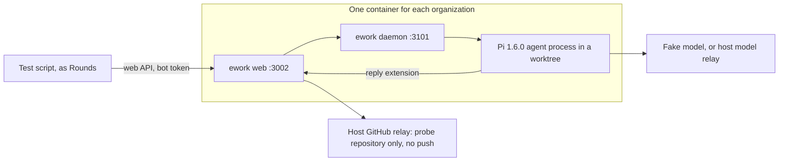

# ework integration tests (2026-11-25)

This report records the tests of ework as a possible execution backend for Bouncer mode. ework is an issue-driven agent daemon (https://github.com/ranxianglei/ework). The tests used snapshot `b71ed91204982740fb7558a376c744c43b31b32d`. ework is a candidate only. No decision selects it.

## Verdict

ework does the core loop. A local or GitHub issue starts a Pi agent process in a Git worktree. The process sends a result, and a follow-up resumes the same Pi session. A real model completed a small coding task. One container for each organization keeps the data of two organizations apart.

ework is not safe to use as is. The tests found gaps that lose work, run work again after a cancel, or let a local caller control the daemon. Rounds can work around some of them. The others need changes to ework. See [Gaps](#gaps).

## Setup

| Item | Value |
|---|---|
| Image | Built from the reviewed source (the pinned npm version does not exist). Ubuntu 24.04, Node 22.23.3, Pi 1.6.0, Bun. |
| Models | Fake OpenAI-compatible models for most checks. One real task used a host relay that allowed one small model and 40 requests. |
| GitHub | Live writes only in the private repository `HenryQW/ework-bouncer-probe-20261125`, through a host relay that adds the token, allows only that repository and refuses `git push`. |
| Result delivery | Stock Pi has no reply tool. A disposable Pi extension posted each result through the ework web API. |
| Method | Seven test streams ran in parallel, each in its own task-owned container. Each check needed positive evidence. Timing checks ran two times. |

## Results

| Row | Area | Result | Main evidence |
|---|---|---|---|
| 1 | Dispatch API | Create, status and follow-up pass. A follow-up sent with the daemon's own token does not wake the agent process. | api A1 to A3 |
| 1 | Daemon API access | **Fail.** `GET /api/status`, `/sessions`, `/processes` and `DELETE /api/processes/{key}` work with no credentials. | api A5; routing R3 |
| 2 | Result delivery | With the disposable reply extension, each result reached its issue one time. **Fail for stock Pi:** it has no reply tool, so the daemon nudges one time, then sets `ai_status=failed`. | api A2, A7; real M1 |
| 3 | Publication gate | **Fail.** Sync adds labels on GitHub, and the mirror posts comments and reactions. No project setting stops these writes. | github G3; relay log lines 84, 98, 124, 126 |
| 4 | GitHub sync | Polling import, follow-up and the outbound mirror pass. The mirror does not echo or import its own comments. ework has no GitHub webhook receiver. All requests stayed in the probe repository. | github G1, G2, G4 to G6 |
| 5 | Crash recovery | A crash after the reply, and a supervisor restart, recover with one reply. A new container with a new hostname never runs the interrupted work again, because ework names each daemon by its hostname. With a fixed hostname, the work ran again after about 5 minutes. **Fail:** each replay sends the prompt two times, and a restart sent SIGTERM to an unrelated process with a reused PID. | crash C1 to C6; ops O4 |
| 6 | Checkouts and cleanup | **Fail.** The first-checkout lock does not lock: in 10 runs, 13 of 20 checkouts fell back to a full clone. A half-made workdir is used as is. Cleanup, when enabled, deletes uncommitted work. | checkout K1 to K5 |
| 6 | Branches of older worktrees | **Fail.** Each new worktree runs `fetch --prune` into local branches, which deletes the `wt-*` branch of each older worktree. A real-model commit lost its branch this way. | github; real M1 |
| 7 | Two organizations | One container for each organization keeps data apart. **On the default Docker bridge, organization B read organization A's daemon status.** A separate network for each organization stops this. ework has no organization concept, so Rounds must route each issue to the correct container. | routing R1 to R4 |
| 8 | Trust | The global wake list works. **Fail:** a wake list on the project only does not block other users. With no list, every author is trusted. | api A6 |
| 9 | Real model | Pass. The model made and committed `HELLO.md` and replied with the commit hash, one time. 4 requests, 27,428 prompt tokens. | real M1; model relay log |
| 9 | Stuck detection | The detector runs every 5 minutes. **"Gave up" does not stop work:** a sweep starts the agent process again, and the issue ends `failed` after the third kill. | real M2 |
| 9 | Cancel | **Fail:** `DELETE /api/processes/{key}` stops the process, but a sweep starts it again after about 3m47s. `POST /api/admin/stop-work` cancels and stays cancelled. | api A4 |
| 10 | Image, start, upgrade, stop | Pass. A source-built image starts healthy in 5 to 6 s. An upgrade to a new image keeps the database, the Pi sessions and the worktrees (22 of 22 checks, two runs). A stop takes less than 3 s. A rebuild gave the same top-level versions, but 2 of 538 npm packages drifted, because the install does not use `bun.lock`. The `no such table: d_daemons` messages are harmless noise. | ops O1 to O6 |

## Gaps

| Gap | Effect | Rounds workaround | Source |
|---|---|---|---|
| Daemon API has no authentication | Any process that reaches port 3101 can read status and stop work | Do not publish the port. Give each organization its own Docker network. A host caller still needs a port on 127.0.0.1. | api A5, routing R3 |
| First-checkout lock does not lock | Parallel first checkouts of one repository fall back to full clones on `main` | None. Fix: `mkdirSync(lockDir)` without `recursive` (`opencode.ts:400`). | checkout K1, K5 |
| `fetch --prune` deletes older `wt-*` branches | Unpushed agent commits lose their branch | None. Needs a change in `opencode.ts:415`. | github, real M1 |
| Half-made workdir used as is | The agent process gets an empty or broken directory | None | checkout K3 |
| Cleanup deletes uncommitted work | Work loss when retention is on | Keep `workdirTtlDays` at 0 (the default) | checkout K4 |
| `DELETE` cancel does not hold | Cancelled work runs again | Use `stop-work` only | api A4 |
| "Gave up" is not final | Stuck work runs again | None | real M2 |
| Daemon identity is the hostname | A new container with a new hostname never runs the interrupted work again | Give each organization's container a fixed `--hostname` | crash C4, ops O4 |
| Slow recovery after a restart | The daemon starts before the web app. Interrupted work waits about 5 minutes for a sweep and shows `running` with an old PID until then. | Accept the delay, or restart with `supervisorctl` (replay after 7 s) | crash C3a, C3b; ops O4 |
| Prompt sent two times on replay | Duplicate instructions in the session | None | crash C5 |
| PID reuse | A restart can signal an unrelated process | None | crash C6 (ework issue #71) |
| GitHub writes without a gate | Labels, comments and reactions reach GitHub with no approval | Do not wire the mirror. Give sync a read-only token. | github G3 |
| Project wake list does not block | Untrusted authors can start agent processes | Set the global wake list | api A6 |
| Head commit read from `master` | HTTP 422 on repositories that use `main` | None | github; `web/src/upstream-sync.ts:829` |
| Poll period is global (45 s) | The project interval has no effect | None | github G1 |

## Not tested

- Claude Desktop. It is out of scope for these tests.
- Rounds dispatch from the app. Test scripts used the ework APIs in place of Rounds.
- Cancel together with closing the issue, pause, or `dispatchOff`.
- Two daemons that share one base directory.
- Recovery after `docker restart` for longer than 120 s. The 5-minute sweep probably runs the work again, as it did after a stop and start with a fixed hostname, but no test observed it.
- Token scopes. The GitHub relay added a full token.

## Decisions

Owner decisions, all 2026-11-25. The first two are in [decisions.md](../../decisions.md).

| Decision | Where |
|---|---|
| GitHub Issues is the version one tracker | decisions.md, commit `49e6ade` |
| One ework container for each organization | decisions.md, commit `f257300` |
| Live GitHub tests use the existing `gh` login, in the probe repository only | Run brief |
| One real model task, capped at US$2 | Run brief; the task used 4 of the 40 allowed requests |

Run choices that did not need the owner:

- The image was built from the reviewed source, because the pinned npm version does not exist.
- Host relays added the GitHub token and the model key, so no secret entered a container.
- The background runner stopped 5 streams after 10 minutes. Those streams ran again with a longer limit, and their first-attempt logs are not evidence.
- The test secrets were deleted at the end (relay keys, env files, header files, bot tokens). Logs and data directories stay.

## Upstream reports

The owner chose to report the gaps to the ework project (decisions.md, 2026-11-25) and approved each report. All were sent on 2026-11-25 against `b71ed912`, which was still the upstream `master`.

| Report | Gaps |
|---|---|
| [#71 comment](https://github.com/ranxianglei/ework/issues/71#issuecomment-7161494712) | PID reuse reproduced; PIDs are never cleared |
| [#72](https://github.com/ranxianglei/ework/issues/72) | Checkout lock, `fetch --prune`, half-made workdir, cleanup |
| [#73](https://github.com/ranxianglei/ework/issues/73) | `DELETE` cancel and "gave up" do not stop work |
| [#74](https://github.com/ranxianglei/ework/issues/74) | Hostname identity, boot recovery before web, prompt sent two times |
| [#75](https://github.com/ranxianglei/ework/issues/75) | Project wake list (security route, summary only) |
| [#76](https://github.com/ranxianglei/ework/issues/76) | `master` hard-coded, global poll period, no read-only mode |

The daemon API without authentication is not reported: `packages/daemon/SECURITY.md` makes firewalling port 3101 the operator's job.

## Cleanup

On 2026-11-25, with the owner's approval, the 6 test images, the last probe container and the probe repository `HenryQW/ework-bouncer-probe-20261125` were removed. The repository now returns HTTP 404.

## Evidence

The test files are in `/tmp/rounds-ework-test.ittpnE` on the owner's Mac. That directory is disposable. A copy of the scripts, logs and `RESULT.md` files, without data directories or secrets, is in `.context/ework-tests-2026-11-25.tar.gz` in the owner's checkout (not tracked). Use these scripts to test a fixed ework again. Each `RESULT.md` cites its logs by file and line.

| Stream | Rows | Result file |
|---|---|---|
| api | 1, 2, 8, 9 (cancel) | `/tmp/rounds-ework-test.ittpnE/it-api/RESULT.md` |
| github | 3, 4 | `/tmp/rounds-ework-test.ittpnE/it-github/RESULT.md` |
| crash | 5 | `/tmp/rounds-ework-test.ittpnE/it-crash/RESULT.md` |
| checkout | 6 | `/tmp/rounds-ework-test.ittpnE/it-checkout/RESULT.md` |
| routing | 7 | `/tmp/rounds-ework-test.ittpnE/it-routing/RESULT.md` |
| real | 2, 6, 9 | `/tmp/rounds-ework-test.ittpnE/it-real/RESULT.md` |
| ops | 5, 10 | `/tmp/rounds-ework-test.ittpnE/it-ops/RESULT.md` |

The relay logs are `relays/github-relay.log` and `relays/model-relay.log` in the same directory. Earlier single-container probes are in `.context/ework-experiment.md` (not tracked).

At the end of the run, every task-owned container was stopped, no task network remained, and both relays were stopped.
