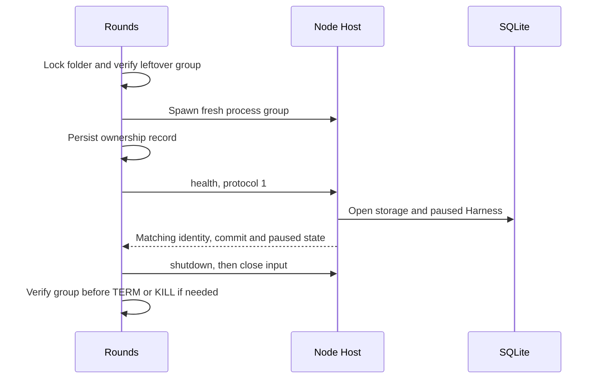

# Slice 02a walkthrough

| File | Lines | Bytes |
|---|---:|---:|
| `Sources/RoundsCore/NodeHarnessHost.swift` | 470 | 20,970 |
| `Resources/harness-host.mjs` | 72 | 3,214 |
| `Sources/Rounds/BouncerModel.swift` | 353 | 15,922 |
| `scripts/build-harness-host.sh` | 44 | 2,231 |
| `scripts/bundle.sh` | 50 | 2,336 |
| `Tests/RoundsCoreTests/NodeHarnessHostTests.swift` | 442 | 19,693 |

## Boundary

Only the Node Host lifecycle is built. The existing Bouncer adapter remains until 02b. Tools remain in 02c.



The first health request gates storage opening. Input closure before that request ends an interrupted launch.

The actor checks kernel birth identity, user, group and the leader argument marker before signalling.
It records verified descendant births during health checks and shutdown.

Recorded descendants can be verified after leader exit. Unknown descendants without a verified parent chain block cleanup. Detached descendants remain Open.

## Build and validation

`--filter` selects a named test. `ROUNDS_PI_SOURCE` supplies a local source; without it, packaging fetches the exact pin.

```sh
scripts/test.sh
scripts/test.sh --filter harnessHostRejectsWrongHealthIdentity
ROUNDS_PI_SOURCE=/absolute/path/to/pi scripts/bundle.sh
git diff --check
```

| Check | Result |
|---|---|
| Source | Verified `5a14e69c067d40dfbff4f2fff7d3b34c897e2dc9`; the fresh build and local export probe pass |
| Full suite | 374 tests pass, including the live Harness check |
| Real Harness | A scratch database opens. Health reports paused. Stop reaps Node and leaves no live group member. |
| Packaging | The release build, local ad hoc signature and native smoke check pass with a payload that starts without executable permissions. |
| Remaining checks | The hosted release workflow and visible window were not exercised. Detached descendants remain open. |

The fresh build used standalone arm64 Node `26.13.1`, the release workflow version.

See the [slice brief](../../02-node-harness-host.md) for the review findings and open work.
