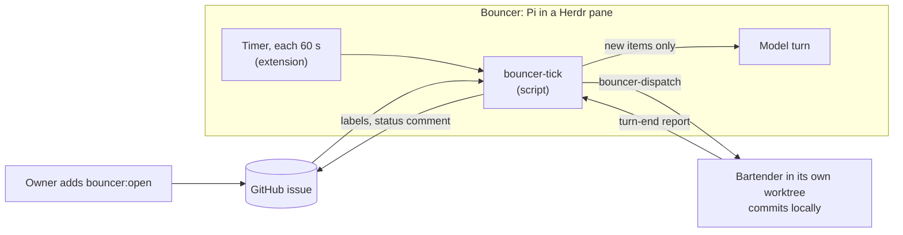

# The Pi Bouncer claim loop

An experimental Bouncer that runs in a Pi terminal session in a Herdr pane, beside the Claude desktop Bouncer. It claims GitHub issues that the owner marks, starts a Bartender for each claim, and records the result on the issue. See the [decision log](decisions.md), entries of 2026-11-26.

The loop has two parts: a **ledger** (the GitHub issue) and a **wake** (a turn that the Bouncer gives itself). Scripts do each step that a rule can decide. The model gets a turn only for an item that needs judgment.



The Bouncer **pulls**. Nothing pushes into it.

## Rules

| # | Rule | Why |
|---|---|---|
| 1 | The issue and the live state are the authority. A wake carries no data that can be lost. | A lost or repeated wake is then harmless. The retired `pi-subagent` package could not keep a report queue correct across session changes. |
| 2 | The Bouncer is the only GitHub writer. A Bartender commits locally and writes nothing that other people read. | One writer gives one gate. |
| 3 | Identity is in names and one local ref, not in a store. Branch `bouncer/<issue>-<slug>`, agent `bt-<repo>-<issue>`, dispatch mark `refs/bouncer/<issue>` at the base sha. | The mark is the first write of a dispatch and an atomic create. A second dispatch of one issue stops before any write, also after a failure that left no branch. |
| 4 | No daemon. Herdr keeps the Bouncer pane open. | Pi starts a turn only from user input or from an extension in the same process. |
| 5 | Nothing is deleted automatically. The Bouncer lists a finished worktree; the owner removes it. | Automatic cleanup is where ework destroyed work. |
| 6 | A script does each step that a rule can decide. The model gets an item only when a script marks it as unsure. | A skill instruction can be skipped or done differently on each run. A script does the same thing each time and has a test. |

The Bouncer claims work only while its Pi process runs. A Pi crash, `herdr server stop` or a restart of the Mac stops claims until the owner starts the Bouncer again. Rounds shows no row for a Pi session with no process (spec 2.7), so this stop is silent.

## Who does each step

| Step | Done by | Where |
|---|---|---|
| Find the state and the next action of each issue | Script | `bouncer-reconcile` |
| Fetch `origin/main` and give the worktree that exact sha | Script | `bouncer-dispatch` |
| Claim: swap `bouncer:open` for `bouncer:claimed` | Script | `bouncer-dispatch` |
| Start a Bartender: worktree, Pi, brief from a fixed template | Script | `bouncer-dispatch` |
| Read a turn-end report, check its commit, write the status comment | Script | `bouncer-record` |
| Run the steps above in order inside the cap, and print the items left | Script | `bouncer-tick` |
| Run `bouncer-tick` each 60 s, and wake the model only for new items | Extension | `pi-herdr-tools` module |
| Block `git push`, `gh` and `herdr_handoff` in a Bartender; confirm a push or a pull request in the Bouncer | Extension | `pi-herdr-tools` module |
| Answer a Bartender's question, or judge a report that a script cannot read | Model | skill |
| Talk to the owner | Model | skill |
| Push, open a pull request | Owner confirms the exact command | gate |
| Remove a finished worktree | Owner | `/done` |

The scripts are in the `henry` skill, each with a fixture test. Their config is `bouncer.json` in the extension config home (pi-harness ADR 018), `~/.pi/agent/config/pi-herdr-tools/bouncer.json`: the tick path and interval for the extension, then the owner, the cap, the write level of each organization and the repositories to watch. `$BOUNCER_CONFIG` overrides the path for the scripts.

One pass runs at a time. The tick holds the lock file `bouncer.lock` in the Pi agent folder for the whole pass. A `bouncer-dispatch` or `bouncer-record` run outside a tick takes the same lock and stops with exit 3 when a pass holds it. A dry run takes no lock.

## The turn-end report

The brief tells the Bartender to end each turn with this block, as the last lines of its reply. `bouncer-record` reads it from the Bartender's Pi session file.

```text
BOUNCER-REPORT
status: done | question | blocked | failed
commit: <full sha of HEAD, or none>
summary: <one line>
question: <one line, or none>
```

`done` counts only when `commit` is the worktree `HEAD` and that commit is ahead of the base, the sha in the dispatch mark. A missing block, a bad field, a commit that does not match or a missing mark goes to the model as unsure.

`bouncer-record` reads only the last assistant message of the newest session file. Its identity is the session file and the entry id, and the tick digest includes it. So a new reply wakes the Bouncer one time, also when its text repeats an earlier question, and a reply with no text (a tool call cut short) is unsure.

## GitHub writes for each organization

Each organization has a write level. The scripts make these writes with no yes each time. Push and pull requests always ask, in the Bouncer, with the exact command.

| Organization | Writes with no yes |
|---|---|
| `HenryQW` | Labels, and one status comment for each issue, edited in place |
| `SleekFlow` | Labels |
| Any other | None. The scripts do not watch a repository whose organization has no level. |

The owner creates the labels in each repository. The scripts only add and remove them.

| Label | Set by | Meaning |
|---|---|---|
| `bouncer:open` | Owner | The Bouncer can claim this issue. |
| `bouncer:claimed` | Script | One Bartender has this issue. A claim removes `bouncer:open`. Only the owner adds it again. |

## Reconcile

`bouncer-reconcile` reads the issues, `herdr agent list`, `git worktree list`, the local `bouncer/*` branches and the dispatch marks. It gives one state and one action for each issue. It writes nothing. The Bartender of a worktree is the agent with the name `bt-<repo>-<issue>` in it; another agent in the worktree counts only when that name is absent (the owner resumed the work by hand).

| State | Action |
|---|---|
| `open` | `claim`, inside the cap and only when `origin/main` resolves; else `hold` with the reason |
| `open-untrusted` (author is not the owner) | `skip` |
| `live` | from the Bartender status: `none` when it works, `read-report` when its turn ended, `answer` when it waits for input |
| `orphan` (claimed, a dispatch mark, worktree or branch, no live agent) | `report`; never dispatch again |
| `claimed-empty` (claimed, no worktree, no branch) | `dispatch`, inside the cap |
| `unclaimed-worktree` | `report` |
| `closed-worktree` | `list-for-removal` |

## Dispatch

`bouncer-dispatch <Owner/repo> <issue>` acts only when reconcile gives the issue `claim` or `dispatch`. It does each step and checks it before the next:

1. Take the lock. Stop when the dispatch mark or a `bouncer/<issue>-*` branch exists.
2. Read the issue again. It stops when the issue is not open, when the author is not the owner, or when the labels do not fit the action (a withdrawn issue has no `bouncer:open`). The brief gets the issue text and the owner's comments only.
3. `git fetch origin main` and read the sha of `FETCH_HEAD`. It never uses `--prune` and never writes a local branch, so a stale local `main` and the owner's own branches stay as they are.
4. Write the dispatch mark at that sha, then claim, for the action `claim`.
5. `herdr worktree create` from that exact sha, `herdr agent start` with Pi, the brief in the worktree's Git folder (`git rev-parse --git-path bouncer-brief.md`), then `herdr agent prompt`.

A failure after the mark stops the script and names what it kept. It never tries again and never deletes. The next reconcile shows the issue as an orphan for the owner, who removes the work with `/done` and `git update-ref -d refs/bouncer/<issue>`. `--dry-run` does the reads, reads the base with `git ls-remote`, and prints the writes.

## Safety

- Claim only an issue that the owner wrote. Anyone can write on a public repository.
- Cap: 2 Bartenders in total, 1 for each repository.
- The gate stops a mistake, not a hostile model. The decision "Authority and approval enforcement" stays not met.
- The extension is an internal module of `@henryqw/pi-herdr-tools` in `HenryQW/pi-harness`, not a new package. ADR 021 of that repository puts each Herdr workflow in that one package. The package loads in every Pi session in Herdr, Bartenders included, so the gate reaches them.
- One Bouncer on one Mac. Two Bouncers on one GitHub account can claim the same issue.

## Slices

The [test report](pi-loop-test.md) gives the results of slices 2 to 6, the findings and what is not verified.

| # | Slice | Proof |
|---|---|---|
| 1 | `bouncer-reconcile` (done) | A fixture test covers each state. A live run gives the real issues their correct states. |
| 2 | `bouncer-dispatch` (done) | A fixture test with real Git: the new checkout sits at the fetched sha although local `main` is behind, a second run starts nothing, an issue from another author is not claimed, a failed start keeps an orphan. Live, in a private test repository: one issue gets a worktree at the remote `main`. |
| 3 | `bouncer-record` (done) | A fixture test for each report case. Live: a repeated run leaves one comment, and `SleekFlow` gets no comment. |
| 4 | `bouncer-tick` (done) | A fixture test: it runs the actions in cap order, prints only the items left, and a second idle run does nothing. |
| 5 | The extension: timer, wake and gate (done) | A Bartender turn end gives exactly one Bouncer turn. One idle hour gives zero turns. A push in a Bartender is blocked. A push in the Bouncer shows a confirm with the exact command. |
| 6 | The skill, for the model items only (done) | A question from a Bartender reaches the owner, and the answer reaches the Bartender. |

Not in version one: a Bartender-side report writer, a relay into the Bouncer, report ids in the session, a claim lease, automatic cleanup, automatic resume of an orphan, a daemon, a second Bouncer, Barbacks, and Bartender rows as subagents in Rounds.
