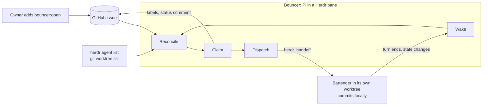

# The Pi Bouncer claim loop

An experimental Bouncer that runs in a Pi terminal session in a Herdr pane, beside the Claude desktop Bouncer. It claims GitHub issues that the owner marks, starts a Bartender for each claim, and records the result on the issue. See the [decision log](decisions.md), entries of 2026-11-26.

The loop has two parts: a **ledger** (the GitHub issue) and a **wake** (a turn that the Bouncer gives itself). The other parts exist already: `herdr_handoff` starts a Bartender in a new worktree, and `background_command` wakes an idle Pi session when a command ends.

The Bouncer **pulls**. Nothing pushes into it.

## Rules

| # | Rule | Why |
|---|---|---|
| 1 | The issue and the live state are the authority. A wake carries no data that can be lost. | A lost or repeated wake is then harmless. The retired `pi-subagent` package could not keep a report queue correct across session changes. |
| 2 | The Bouncer is the only GitHub writer. A Bartender commits locally and writes nothing that other people read. | One writer gives one gate. |
| 3 | Identity is in names, not in a store. Branch `bouncer/<issue>-<slug>`, agent `bt-<repo>-<issue>`. | `herdr_handoff` refuses a branch that exists, so a second dispatch of one issue fails by itself. |
| 4 | No daemon. Herdr keeps the Bouncer pane open. | Pi starts a turn only from user input or from an extension in the same process. |
| 5 | Nothing is deleted automatically. The Bouncer lists a finished worktree; the owner removes it. | Automatic cleanup is where ework destroyed work. |

The Bouncer claims work only while its Pi process runs. A Pi crash, `herdr server stop` or a restart of the Mac stops claims until the owner starts the Bouncer again. Rounds shows no row for a Pi session with no process (spec 2.7), so this stop is silent.

## GitHub writes for each organization

Each organization has a write level. The Bouncer makes these writes with no yes each time. Push and pull requests always ask, in the Bouncer, with the exact command.

| Organization | Writes with no yes |
|---|---|
| `HenryQW` | Labels, and one status comment for each issue, edited in place |
| `SleekFlow` | Labels |
| Any other | None. The Bouncer does not watch a repository whose organization has no level. |

The owner creates the labels in each repository. The Bouncer only adds and removes them.

| Label | Set by | Meaning |
|---|---|---|
| `bouncer:open` | Owner | The Bouncer can claim this issue. |
| `bouncer:claimed` | Bouncer | One Bartender has this issue. A claim removes `bouncer:open`. Only the owner adds it again. |

## The wake, cheapest first

1. The owner types one word. This is always available.
2. A `bouncer-wait` script under `background_command` ends when the reconcile output changes. Its completion arrives as a `followUp` message with `triggerTurn`.
3. A small extension with a timer that starts in `session_start`. Use it only if step 2 is too coarse.

A wake fires only on a difference, one wake at a time, with a 60 second minimum. The Bouncer's own label write must not wake it again.

## Reconcile

The `bouncer-reconcile` script reads the issues, `herdr agent list`, `git worktree list` and the local `bouncer/*` branches. It gives one state and one action for each issue. It writes nothing. The script is in the `henry` skill, with a fixture test; its config is `~/.config/bouncer/config.json` and holds the owner, the cap, the write level of each organization and the repositories to watch.

| State | Action |
|---|---|
| `open` | `claim`, inside the cap and only when local `main` equals the remote `main`; else `hold` with the reason |
| `open-untrusted` (author is not the owner) | `skip` |
| `live` | from the Bartender status: `none` when it works, `read-report` when its turn ended, `answer` when it waits for input |
| `orphan` (claimed, a worktree or branch, no live agent) | `report`; never dispatch again |
| `claimed-empty` (claimed, no worktree, no branch) | `dispatch`, inside the cap |
| `unclaimed-worktree` | `report` |
| `closed-worktree` | `list-for-removal` |

`herdr_handoff` bases the new worktree on local `main` and does not fetch. So a stale `main` gives a stale Bartender, and a repository with no `main` branch cannot use the loop.

## Safety

- Claim only an issue that the owner wrote. The brief holds the issue body and the owner's comments only, because anyone can write on a public repository.
- Cap: 2 Bartenders in total, 1 for each repository.
- A `tool_call` handler blocks `herdr_handoff`, `git push` and `gh` in a Bartender session, so a Bartender cannot start workers or write to GitHub. This stops a mistake, not a hostile model. The decision "Authority and approval enforcement" stays not met.
- One Bouncer on one Mac. Two Bouncers on one GitHub account can claim the same issue.

## Slices

| # | Slice | Proof |
|---|---|---|
| 1 | `bouncer-reconcile`, a read-only script | A fixture test covers each state. A live run gives the real issues their correct states. |
| 2 | The skill, with a manual wake | In a private test repository, one issue gets a worktree at the remote `main`. A second wake starts nothing. An issue from another author is not claimed. |
| 3 | The self wake through `background_command` | A Bartender turn end gives exactly one Bouncer turn. One idle hour gives zero turns. A restart starts no second worker. |
| 4 | The gate and the status comment | The cap holds. A push in a Bartender is blocked. A repeated wake leaves one comment. |

Not in version one: a Bartender-side report writer, a relay into the Bouncer, report ids in the session, a claim lease, automatic cleanup, automatic resume of an orphan, a daemon, a second Bouncer, Barbacks, and Bartender rows as subagents in Rounds.
