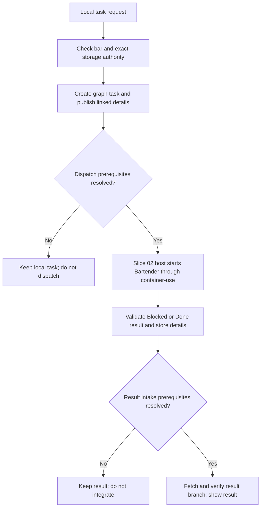

# 03 Dispatch and results

## Goal

The Bouncer gives a task to a Bartender and gets its result back. The result arrives as branch `container-use/<env>` with a Blocked or Done record. No protected action runs in this slice.

## State

Local task records are built. A local runtime verifies dispatch, Blocked continuation and result intake across two disposable repositories. The running app still needs the integrations in [Open](#open).

The storage in this brief (one bar, approved detail folders for each organization) is superseded by decision "One bar for each organization" (2026-11-24). The storage check and the detail store now use one private bar for each organization, with the task graph in `tasks/graph` and the details in `tasks/details` of that bar ([spec 2.7.2](../../spec.md#272-bar-setup), built 2026-11-24). A nil organization cannot store tasks. Read the rows below about detail folders, acknowledgement and unclassified folders with that change.

## Read first, in full

| Read | Purpose |
|---|---|
| [AGENTS.md](../../../AGENTS.md), [DESIGN.md](../../../DESIGN.md), [GLOSSARY.md](../../../GLOSSARY.md) | Project rules, existing components and product terms |
| [Spec 2.7](../../spec.md#27-pi-sessions), [2.8](../../spec.md#28-tickets), [3](../../spec.md#3-classification) | Organization checks, bar setup and session classification; include every subsection |
| This brief, [01](01-bouncer-mode.md), [02](02-node-harness-host.md), [slice index](README.md) | Scope, adapter boundary and Node Host prerequisites |
| [Overview](../overview.md), [decisions](../decisions.md), [context](../CONTEXT.md) | Agreed behavior, owner decisions and task/session distinction |
| [Bouncer review](../archive/bouncer-review.md), [plan](../archive/plan.md) | Evidence and proposals; proposals do not replace owner decisions |
| [Bar.swift](../../../Sources/RoundsCore/Bar.swift), [TaskGraph.swift](../../../Sources/RoundsCore/TaskGraph.swift), [TaskDetailStore.swift](../../../Sources/RoundsCore/TaskDetailStore.swift), [TaskRecordStore.swift](../../../Sources/RoundsCore/TaskRecordStore.swift) | Actual setup checks, graph validation and detail publication contracts |
| [Bar tests](../../../Tests/RoundsCoreTests/BarTests.swift), [graph tests](../../../Tests/RoundsCoreTests/TaskGraphTests.swift), [detail tests](../../../Tests/RoundsCoreTests/TaskDetailStoreTests.swift), [record tests](../../../Tests/RoundsCoreTests/TaskRecordStoreTests.swift) | Existing boundaries and regression coverage |
| Pinned Pi source listed under Contracts | Conversation creation, child ownership, tool exposure and scheduling |

Read the living-docs skill, section "Slice brief", before changing this brief. The checked source is `~/.local/share/magpie/shared-skills/skills/living-docs/SKILL.md` on `vps`.

## Depends

[Slice 01](01-bouncer-mode.md) supplies the Bouncer conversation and window. [Slice 02](02-node-harness-host.md) supplies the Node Host, durable adapter, approved storage, models and container-use wrapper.

Sub-step 1 can merge before slice 02. Sub-steps 2 and 3 require its completed host and recovery checks.

## Builds

| Sub-step | State | Deliverable | Validation |
|---|---|---|---|
| 1 | Built | Local task interface over the existing graph and detail stores | Calls with temporary stores exercise storage and authorization without a runtime host |
| 2 | Local fixture | Bartender execution and Blocked continuation with a trusted authority adapter | Reopen the database and the same container after an engine restart |
| 3 | Local fixture | Verified branch intake and a two-repository dependency workflow | Read both exact result revisions and confirm both checkouts keep their working tree changes |

## Files

| Path or boundary | Sub-step | Role |
|---|---|---|
| [TaskInterface.swift](../../../Sources/RoundsCore/TaskInterface.swift) | 1 | Implements local task operations through the bar storage check |
| [Bar.swift](../../../Sources/RoundsCore/Bar.swift) | 1 | Checks folder readiness and resolves the approved detail folder |
| [TaskGraph.swift](../../../Sources/RoundsCore/TaskGraph.swift), [TaskDetailStore.swift](../../../Sources/RoundsCore/TaskDetailStore.swift), [TaskRecordStore.swift](../../../Sources/RoundsCore/TaskRecordStore.swift) | 1 | Own graph validation, immutable revisions and detail-first linking |
| [TaskInterfaceTests.swift](../../../Tests/RoundsCoreTests/TaskInterfaceTests.swift) | 1 | Exercises local calls with temporary stores |
| [harness-task-dispatch.mjs](../../../Resources/harness-task-dispatch.mjs), [harness-container-run.mjs](../../../Resources/harness-container-run.mjs) | 2, 3 | Bind local runs to Harness conversations, check restart state and import the exact result revision |
| [test-harness-task-dispatch.mjs](../../../scripts/test-harness-task-dispatch.mjs) | 2, 3 | Verify the workflow with SQLite, a fixture model and an optional disposable engine |
| [BouncerAdapter.swift](../../../Sources/RoundsCore/BouncerAdapter.swift), [Bouncer.swift](../../../Sources/RoundsCore/Bouncer.swift), [BouncerModel.swift](../../../Sources/Rounds/BouncerModel.swift) | 2, 3 | Extend the durable adapter and project records into existing task/report/question events |
| [Bouncer tests](../../../Tests/RoundsCoreTests/BouncerTests.swift) and slice 02 host tests | 2, 3 | Check protocol boundaries and real branch intake; do not restore the removed Pi process adapter |
| [Spec](../../spec.md), this brief, [slice index](README.md) | Each | Record only behavior that the sub-step implements and verifies |

No new window design belongs here. Use the chosen slice 01 components. The Node Host file layout is a dependency of slice 02, not an invented layout in this brief.

## Contracts

### Local task interface

| Boundary | Contract |
|---|---|
| Scope | Each call supplies its organization scope and exact authorized graph/detail destinations. Do not infer authority from assignment text or a Git remote. |
| First check | Each `TaskInterface` call checks `BarSettingsStore.mayStoreTaskDetails(for:)`. A false result stops the operation before it accesses the stores. |
| Destination | The interface resolves the approved folder with `taskDetailFolder(for:)` and checks it against the caller's detail destination. |
| Authorization | The caller supplies separate authority for graph values and detail values at their exact destinations. A detail link grant covers its reference, generation, timestamp and viewed-status reset. |
| Unclassified input | A nil organization selects the existing unclassified folder. It grants no model transmission. Do not convert a conflicting classification into an unclassified permission. |
| Create | `create` authorizes and saves the graph candidate, then publishes and links assignment details. New tasks start in `queued` with an empty detail reference. |
| Read and revise | `read` loads the authorized graph and its linked revision. `revise` checks the expected reference and starts from the current detail values. |
| Concurrent change | The stores reject a stale graph update or detail reference. If the link timestamp changes, the interface requires authority for the effective time before linking. |
| Publication | `TaskCreationResult.saved` confirms creation and linkage. `TaskRecordWriteResult.saved` confirms revision publication and linkage. Other outcomes require inspection. |
| Partial write | A graph task without details or an unlinked detail revision can remain after failure. Report it; do not dispatch, delete it or recreate missing data. |
| Viewed result | Only completed or cancelled graph tasks accept acknowledgement. Call `markResultViewed(_:expecting:at:)` with the displayed reference. A stale view cannot acknowledge a newer result. |
| States | Preserve `TaskGraph` validation. Sub-step 1 adds no run-state transition policy or mapping from a Pi conversation to a Rounds task. |

`GraphTask` holds identifiers, parent/dependency links, state, viewed status, timestamps and a detail reference. It has no assignment text or session identifier.

`TaskAssignment` holds `objective`, `scope`, `target`, `constraints` and `acceptanceConditions`. Parent and dependency links belong in the graph.

`TaskResult` holds `changedLocations`, `validationOutcomes`, `checkedRevisionOrWorkingTree`, `risks` and `blockers`. It can also hold an authorized repository identifier and folder identity. Local approval requests require both. `TaskProgress` and `TaskDecision` remain separate detail arrays.

`TaskRecordStore.write` publishes details before updating the graph. Its error can identify a published orphan. It is not a transaction across both stores.

### Dispatch and results

These boundaries apply after the blocking Open items are resolved. They do not choose the missing identity or transition policy.

| Boundary | Contract |
|---|---|
| Dispatch request | Reference an existing task and detail revision. Supply its target repository, checkout, explicit instructions and the complete agreed handoff. |
| Dispatch permission | Check applicable organization rules for the model, transcript database, logs, output, temporary files and clone before any content reaches them. |
| Rejection | Missing enrollment, instructions, authority, storage approval or current ownership prevents a run. A rejection does not create a replacement clone. |
| Tool exposure | The Bouncer gets orchestration tools. Bartender code/file commands use only the pinned container-use wrapper. No host shell or file tool enters its callable set. |
| Result envelope | Carry Blocked or Done, the task/run correlation, exact detail reference, environment/branch identity and `TaskResult` fields. Validate correlation before accepting content. |
| Blocked | Include a reason and up to 3 options. End that run. The Bouncer answers or asks the user, then continues from the same clone. |
| Done | Supply the checked revision or working-tree identity and validation outcomes. A successful model turn or process exit alone is insufficient. |
| State mapping | Blocked and Done are handoff outcomes. Their mapping to `TaskGraphState` and `BouncerTaskState` remains open; do not equate their names. |
| Intake | Verify the task repository, environment, branch and fetched revision before presenting changes as checked. Preserve the real working tree. |
| Authority | No tool in this slice pushes, opens a pull request, merges, deploys or performs another protected action. Slice 04 supplies that gate. |

A result can arrive before the dependency or required child is complete. Preserve it without bypassing the existing graph completion checks.

### Pinned Pi facts

The source was read at commit `5a14e69c067d40dfbff4f2fff7d3b34c897e2dc9`. The local probe checkout matched that commit before inspection. These are source facts, not claims that Rounds already implements them.

| Verified source | Fact and consequence |
|---|---|
| [harness.ts, Harness.open](https://github.com/earendil-works/pi/blob/5a14e69c067d40dfbff4f2fff7d3b34c897e2dc9/packages/durable/src/harness/harness.ts#L613) | `Harness.open(storage, options, context)` opens the scheduler. `root(context, options)` obtains or creates the reserved root. |
| [harness.ts, conversation methods](https://github.com/earendil-works/pi/blob/5a14e69c067d40dfbff4f2fff7d3b34c897e2dc9/packages/durable/src/harness/harness.ts#L413) | `createConversation(options, context)` creates an independent conversation. `conversation(id, context)` looks up an existing handle. `submit({ type: "input", content, requestId }, context)` admits input. |
| [transaction.ts](https://github.com/earendil-works/pi/blob/5a14e69c067d40dfbff4f2fff7d3b34c897e2dc9/packages/durable/src/session/transaction.ts#L358), [agent.ts](https://github.com/earendil-works/pi/blob/5a14e69c067d40dfbff4f2fff7d3b34c897e2dc9/packages/durable/src/harness/agent.ts#L207) | A tool can create a task-owned conversation in a commit. Its agent initially copies the owning task conversation's stored agent. Configure its role explicitly before input. |
| [21-subagent-foreground.ts](https://github.com/earendil-works/pi/blob/5a14e69c067d40dfbff4f2fff7d3b34c897e2dc9/packages/durable/test/examples/21-subagent-foreground.ts#L41) | The example registers `defineTool` through `defineExtension` and finds an existing child by owner task. It removes the delegation extension and uses a stable input `requestId`. External effects still need separate replay checks. |
| [types.ts, ToolRegistration](https://github.com/earendil-works/pi/blob/5a14e69c067d40dfbff4f2fff7d3b34c897e2dc9/packages/durable/src/harness/types.ts#L416) | The Harness validates tool parameters. Interrupted tool replay defaults to `unsafe`; declare `safe` only after testing every side effect. |
| [scheduler.ts, open and resume](https://github.com/earendil-works/pi/blob/5a14e69c067d40dfbff4f2fff7d3b34c897e2dc9/packages/durable/src/harness/scheduler.ts#L475), [types.ts, Harness](https://github.com/earendil-works/pi/blob/5a14e69c067d40dfbff4f2fff7d3b34c897e2dc9/packages/durable/src/harness/types.ts#L992) | Open reconciles surviving running tasks to pending without dispatching. `resume()` enables scheduling; submit, abort, compact and wait operations can also enable it. Recovery must precede those calls. |

A Pi task identifier, conversation identifier and Rounds graph task identifier are different identities. This brief does not define their durable mapping.

## How it works

### Sub-step 1: local task records

- `TaskInterface` takes an explicit bar scope and exact store destinations. An explicit setup call initializes the graph.
- Creation publishes and links assignment details after the graph save. Inspection outcomes carry the task identifier.
- Reads authorize the graph snapshot and any linked details. Revisions preserve each value that the edit leaves unchanged.
- The caller can update graph state and acknowledge a viewed result through the existing graph validation.

### Sub-step 2: dispatch and continuation

- Resolve enrollment, instructions, state/identity and storage questions before implementing live dispatch.
- Extend slice 02's registry and Rounds protocol. Keep the task interface as the only record-writing boundary.
- Recheck the target checkout and its single-writer ownership before starting work.
- Create or reacquire the appropriate conversation through the Harness. Apply explicit role tools before submitting the handoff.
- Validate and store the structured result before reporting acceptance to the Bouncer.
- Treat Blocked as an ended run with a retained clone. A later answer must identify that same task and clone.
- After restart, reconcile stored runs, local records, checkout ownership and process identity before any operation enables scheduling.
- Test interrupted external side effects before choosing a replay policy. Pi's stored submissions cannot make container operations exactly once.

### Sub-step 3: branch intake and initial workflow

- Resolve local-only record routing and Barback incorporation before enabling their integration paths.
- Verify the result's repository and environment against the accepted run record. Reject a branch name alone as proof.
- Fetch `container-use/<env>` into the task's real repository through a Rounds-owned fetch operation. Check the fetched revision against the result.
- Fetch directly from the verified private run. Create `refs/remotes/container-use/<env>` only if it is absent or already names the verified revision.
- Keep the real working tree unchanged during fetch. Do not treat fetch as publication or approval to merge.
- Project accepted records into the existing task sidebar and report/question components. Use the resolved state mapping.
- Register two repositories and complete one dependency workflow across them. Verify every handoff and each repository's result separately.
- Keep unresolved or unauthorized cross-organization links blocked. Do not infer a shared record destination from a shared parent task.

This brief defines no clone deletion schedule, checkpoint replacement or new Decision Record coverage. Preserve existing supplied decisions and recovery evidence.

### Local runtime

- A trusted adapter supplies enrollment, instructions, the model, the handoff and permission to store each result. The runtime rechecks that grant before container operations, model requests and result intake.
- The Harness database binds the task and detail identifiers to a conversation and a private run. Blocked work accepts a current answer and opens the same clone. A malformed result records the task as Failed, so the next task can dispatch. Other uncertain work blocks a replacement. Each dispatch inspects only Blocked runs. It keeps the 8 newest Done runs and removes older Done records and their run folders.
- Done includes the revision read after validation. The runtime compares it to the saved result before importing. The fetch and reference update use the verified Git directory.
- The local workflow uses a fixture model and fixture authority. The running Bouncer still needs task registration, local record integration, task presentation and the agreed review path for Barback results.

## Tests

[Local task tests](../../../Tests/RoundsCoreTests/TaskInterfaceTests.swift) exercise sub-step 1. The local workflow covers sub-steps 2 and 3 where indicated above. Run Rounds tests through `scripts/test.sh`.

| Sub-step | Case, boundary first | Required observation |
|---|---|---|
| 1 | Missing bar, malformed settings, unacknowledged changed remotes, or absent approval | The first storage check rejects; neither graph nor details changes |
| 1 | Approved folder disappears, is replaced, becomes a symlink, or loses private ownership/permissions | A fresh operation rejects the destination; no alternate directory receives the data |
| 1 | Organization A is approved; B and unclassified are not | Calls for B and nil fail; A cannot authorize them |
| 1 | Folder readiness succeeds but graph or detail values lack destination authorization | Reject before either write; remote acknowledgement cannot substitute |
| 1 | Missing graph on an ordinary call | Return `missingGraph`; do not initialize or erase recovery evidence |
| 1 | Unknown task or stale detail reference | Reject; preserve the linked revision and report any published orphan |
| 1 | Detail write is not durable, or graph linking fails after detail publication | Surface the exact inspection/link outcome; no success report or dispatch |
| 1 | A new dependency or required-child link would form a cycle or allow premature completion | Existing graph validation rejects the update and preserves the previous graph |
| 1 | Task is nonterminal, or the displayed result reference becomes stale before acknowledgement | `markResultViewed` rejects; a newer terminal result still needs attention |
| 1 | Valid authorized create, revise and reopen | Assignment and current reference survive reopen; graph contains no task text |
| 2 | Missing enrollment, explicit instructions, storage permission or checkout ownership | No model request, conversation input or environment creation occurs |
| 2 | Child inherits the Bouncer's orchestration tools | Role configuration removes forbidden tools before the child's first input |
| 2 | Duplicate dispatch or crash between conversation, submission and environment writes | Reconcile the known operation; never silently start a second clone or writer |
| 2 | Restart leaves an owned wrapper process alive | Verify and stop it before resume, submit, abort, compact or wait can schedule work |
| 2 | Wrong task/run correlation, stale reference, malformed result, or a fourth Blocked option | Reject the result; preserve the current accepted record |
| 2 | One Bartender completes, then a second run reports Blocked and receives an answer | Done records exact checks; Blocked continuation uses its original clone |
| 3 | Wrong repository/environment, missing branch, changed fetched revision, or failed fetch | Keep the working tree intact; do not report verified intake |
| 3 | Result arrives before a dependency or required child completes | Store the result without forcing a graph completion transition |
| 3 | Cross-organization record lacks an authorized destination | No record or link crosses the boundary; integration stays blocked |
| 3 | Bartender consumes Barback output | Test the checked incorporation method after its open question is resolved |
| 3 | Valid local branch intake with unrelated working-tree changes | Verify fetched revision; preserve those changes; no push or protected action occurs |
| 3 | Two enrolled repositories complete one dependency workflow | Both results and checks name the correct repository/revision; parent completion obeys graph validation |

## Numbers

The local task measures describe the built interface. Dispatch and intake measures are targets.

| Measure | Current state or target | Verification |
|---|---|---|
| Source callers of `mayStoreTaskDetails(for:)` | 1 local task interface | Inspect `TaskInterface.checkedStores` and run its allow and deny tests |
| Graph and detail formats | Graph version 3; detail version 1 | Reuse both formats; reopen written records with the existing stores |
| Encoded detail revision size | Maximum 1,048,576 bytes | Preserve the limit; an oversized assignment fails without a linked replacement |
| Runtime dependencies for sub-step 1 | 0 containers and 0 model requests | Run the fixture tests without a host |
| Blocked options | Agreed maximum 3 | Accept at most 3; reject 4 at the result boundary |
| Concurrent writers per checkout | Agreed maximum 1 | Reject a second writer; assert ownership in dispatch and restart tests |
| Initial workflow repositories | Agreed minimum 2 | Complete one dependency workflow across 2 registered repositories |
| Protected actions in this slice | None permitted | 0; inspect exposed tools and assert no publication calls during acceptance |
| Sub-steps | 1 built, 2 verified with local fixtures | Run the remaining cases through the app once the authority adapter and state projection exist |

## Decided

- Decision "Option 3: container-use for all agent work" ([decisions.md](../decisions.md)).
- Handoff and result contents: the Handoff row of the [agreed scope](../overview.md#agreed-scope).
- *default*: Reuse slice 02's host and registry for sub-steps 2 and 3. Configure each role's tools explicitly before input.
- *default*: Stop on uncertain publication, correlation or recovery outcomes. Keep evidence for inspection instead of automatically retrying side effects.

These defaults are implementation proposals. They do not answer Open items or add owner decisions to the decision log.

## Open

Each item remains open. Blockers are direct; later sub-steps also inherit their dependencies' blockers.

| Open item | Effect |
|---|---|
| Define repository enrollment and explicit instruction loading. | blocks sub-step 2 |
| Define task-state transitions and task-to-session identity. | blocks sub-step 2 and sub-step 3 |
| Checkpoints and safe retention remain open. Replacing the Git Checkpoint with the clone is an unapproved proposal in the [bouncer review](../archive/bouncer-review.md#changes). | does not block; the details assume nothing about it |
| Decision Record scope remains open. Recording results and every approval, instead of routine decisions, is an unapproved proposal in the bouncer review. | does not block; the details assume nothing about it |
| How a Bartender takes in the changes of its Barback is not checked. | blocks sub-step 3 |
| Resolve cross-organization links and separate local-only records before integration. | blocks sub-step 3 |
| Before dispatch, check agent transcripts, output, logs and temporary files against organization storage rules. | blocks sub-step 2 |

## Carried

Sub-step 2 takes dispatch and Blocked continuation after the host and recovery checks. Sub-step 3 takes branch intake after dispatch and result recording.
