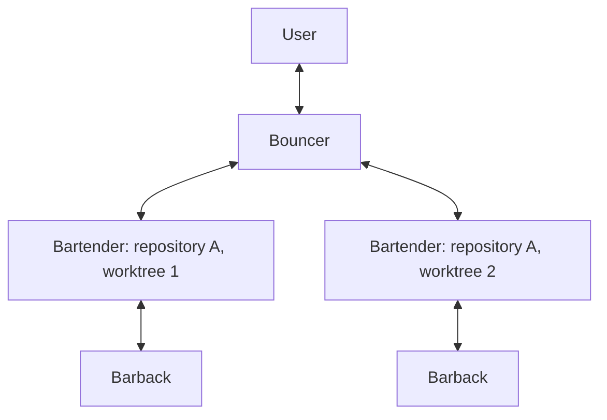

# Bouncer mode overview

Bouncer mode extends Rounds so one user-facing Bouncer coordinates Bartenders and their bounded Barbacks across independent repositories. Durable records must support recovery without the old conversation. Rounds is the product home. The user's Router Workspace is a separate coordination directory, not the Rounds source repository unless the user chooses otherwise. Names are in [CONTEXT.md](CONTEXT.md); decisions are in [decisions.md](decisions.md).

## Goal

The user gives goals in the Bouncer conversation, makes decisions and reviews results. The design removes every other task from the user and keeps the build small. Every other screen is monitoring, and the design must make it unnecessary.

## Built so far

- Organization rules, destination consent and outbound checks: [spec 2.7.1](../spec.md#271-organization-boundaries).
- Workspace setup in Settings > Workspace: [spec 2.7.2](../spec.md#272-workspace-setup). Nothing calls `mayStoreTaskDetails(for:)` until task dispatch exists.
- The task graph and the task detail store are in the source, but the app does not use them yet. Agent dispatch is not built.
- [Slice 02](slices/02-node-harness-host.md) adds the Node Host, SQLite storage and a Bouncer conversation with no tools. The container tool bridge remains in 02c.

## Parts

| Part | Runs where | Holds |
|---|---|---|
| Bouncer | A conversation in the Node Host's pi-durable Harness | The user's conversation. Dispatch and result tools come in slice 03. |
| Node Host | One Node process that Rounds starts and stops | A [pi-durable](archive/reuse-review.md#pi-durable-checked-2026-11-18) Harness with SQLite storage |
| Bartender | A conversation in the Harness | The model sees container-use tools only |
| Barback | A child conversation of its Bartender | The same tool limits; it cannot delegate further |
| container-use | Host process, one for each Bartender | Access to the task repository |
| Environment | Container on the Dagger engine | Clone of the task branch, no credentials. The result is branch `container-use/<env>`. |
| Engine | One shared Docker container, `insecureRootCapabilities` off | Internal network only |
| Egress proxy | Docker container | One allowlist |
| Rounds | Host app | Lifetime of the Node Host, records, approvals, push and draft pull request |

Agents produce and Rounds publishes: agents cannot do a protected action, and Rounds does a closed list of actions on the host only after the user approves the exact list. Version one has two actions: push a branch and open a draft pull request.

## Agreed scope

| Area | Requirement |
|---|---|
| Product | Build in the Rounds repository. Preserve existing session features unless a change is agreed. |
| Workspace | Keep coordination records separate from application code. Setup can use `/router-setup` or a natural-language request. Check whether the chosen directory is already in a Git repository; otherwise ask whether to create one and ask for its name. |
| Storage | Use one Git root with a remote for permitted records and configuration. It can be private or public. Before using a public remote, obtain explicit acknowledgement. When visibility cannot be verified, treat it as potentially public and obtain acknowledgement before use. If organization rules prohibit details in the root, keep them in an approved local location and put only permitted metadata in Git. Show that the details are not remotely backed up by the root. See decision "Root repository visibility". |
| Registry | Keep a stable repository ID, organization, name, aliases, purpose, instruction references, and related repositories. Resolve machine-specific checkout paths separately. |
| Routing | Use one Bouncer conversation for the user, in the Bouncer Window. Prefer an explicitly named repository. Otherwise use aliases, purpose, and project context; inspect ambiguous matches and ask only when the ambiguity changes the work. Do not choose arbitrarily. |
| Instructions | Load applicable shared, organization, and project instructions explicitly. Keep code-specific documentation in the code repository. Load only the organization context needed. |
| Organization boundaries | Apply user-defined organization rules to alerts and ticket lookups for every Rounds session. Match registered repositories to organizations using user-defined directory or Git remote rules. Keep unmatched or conflicting matches local until the user classifies them. Send data remotely only when the applicable rules permit it. |
| Execution | Rounds starts one Node Host that runs a pi-durable Harness. Each Bartender is a conversation in it, and each Barback is a child conversation of its Bartender. Agents get container-use tools only, so all work runs in containers. The Bouncer selects model and thinking level for tasks. Do not allow further recursive delegation. |
| Handoff | Record the objective, scope, target checkout, constraints, acceptance conditions, parent, and dependencies. Results identify changes, validation, the exact checked revision or working tree, risks, blockers, and decisions. |
| Control | Record assignments and state outside model context. Support progress, completion, failure, cancellation, and explicit resumption. Do not treat a Barback report as an instruction. |
| Safety | Assign one integration owner per repository task. Never allow concurrent writers in one checkout. Preserve unrelated changes; do not automatically stash or discard them. |
| Authority | Barbacks ask their Bartender first; the Bartender decides or asks the Bouncer when unsure. If the Bouncer needs user input, present up to three options and recommend one. After Bartender review, relay known approval requests without a Bouncer model turn. The requesting agent waits; unrelated work continues. Protect required approvals with verified isolation and guarded execution. See decision "Authority and approval enforcement". |
| Interface | Bouncer mode of Rounds: the pill is the Bouncer and the Bouncer Window holds the conversation. Rounds still watches all sessions; the session list stays on the global shortcut. See decision "Bouncer mode in Rounds" and [slice 01](slices/01-bouncer-mode.md). |
| Recovery | Bartenders and Barbacks are conversations in the Node Host, which Rounds starts as its child. If Rounds quits, they stop. Reopen the Bouncer conversation from SQLite. Report storage errors and interrupted replies. Reconcile each agent and checkout before work resumes; never restart an uncertain agent until its previous run is proven stopped. Rounds rechecks agents and checkouts itself. Show one row only for a fact it cannot prove, with one safe action. |
| Git history | Commit permitted Task Records to the root branch locally. Push them only when the user asks; version one runs on one machine. Exclude restricted details from the root's commits. Ask before a commit if unrelated changes exist. Do not silently overwrite or remove unrelated work. |
| Deployment | Start on one machine, with one owner per task. Defer distributed compute, a remote Barback fleet, autonomous scheduling, and unrestricted recursion. |

## Acceptance scenarios

| Scenario | Required result |
|---|---|
| Repository request | Select the correct repository and load its guidance. Resolve a consequential ambiguity or ask. |
| Cross-repository work | Link a parent task to repository tasks and dependencies. Do not complete the parent while a required task is incomplete. |
| Hierarchy | Barbacks request input from their Bartender, never directly from the user. The Bartender decides or consults the Bouncer. The Bouncer presents up to three options with one recommendation when user input is required. |
| Concurrent work | Independent writers do not share a checkout. |
| Failure | Report a Barback failure without claiming completion. |
| Restart | On user request, reopen the recorded conversation when available. If it is missing, start a clearly marked new conversation from task records. Report other session access errors and reconcile Bartenders and Barbacks before resumption. |
| Approval | Wait for the required user consent. A rejection includes a reason; unrelated work continues. A pending request survives a restart as a parked pi-durable gate. Rounds rechecks the revision and remote URL itself; if they changed, it drops the request and asks again. |
| Organization | Do not load unrelated organization instructions or store or transmit information outside approved boundaries. Apply alert and ticket lookup rules to every Rounds session; keep unmatched or conflicting matches local until the user classifies them. When the root cannot hold task details, store them locally only with approval for that location; show the remote-backup limit. |
| Initial workflow | Register two repositories and complete one cross-repository workflow. |

## Build order

Build the slices in the order of [slices/README.md](slices/README.md). Each slice has its own tests and spec update. When a slice is built, update the [Rounds specification](../spec.md) and [glossary](../../GLOSSARY.md) with the accepted product behavior.

## Open for the whole project

- Decide how Rounds verifies permission for each alert or ticket service.
- Add a trusted checkout registry before Settings supports Git remote rules. A matching Git remote is not proof of checkout ownership. Keep unknown remotes and unmatched sessions local, and recheck permission before each outbound request.
- Before you plan a complex function, search for suitable open-source projects. Reuse or adapt existing tools when they fit.
