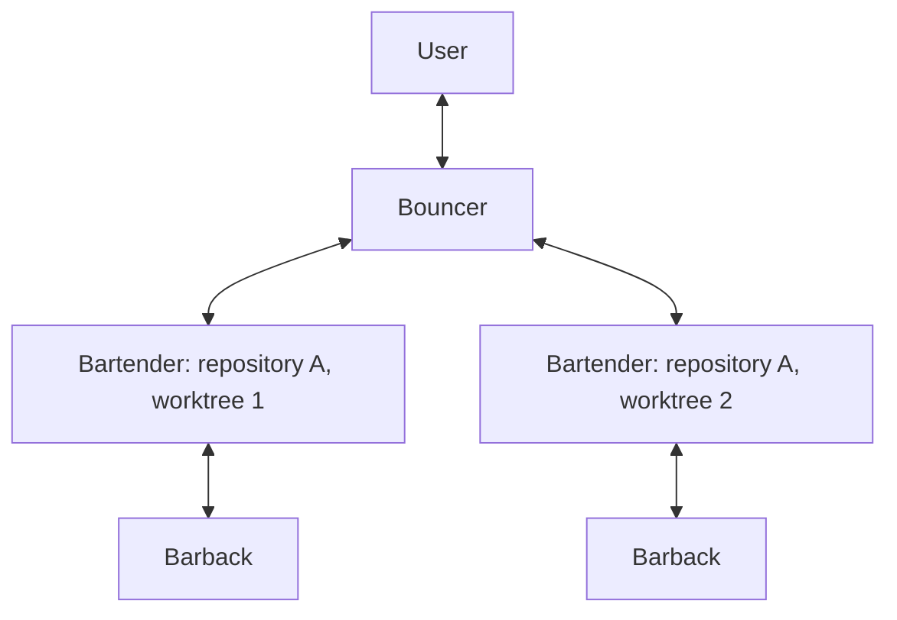

# Router Workspace plan

## Objective and status

Extend Rounds so one user-facing Bouncer coordinates Bartenders and their bounded Barbacks. Durable records must support recovery without the old conversation. The user approved the native task and organization settings mockups and requested implementation to continue until a permission blocker. Organization rules and outbound checks are committed locally; task dispatch is not implemented.

## Agreed scope

| Area | Requirement |
|---|---|
| Product | Build in the Rounds repository. Preserve existing session features unless a change is agreed. |
| Workspace | Keep coordination records separate from application code. Setup can use `/router-setup` or a natural-language request. Check whether the chosen directory is already in a Git repository; otherwise ask whether to create one and ask for its name. |
| Storage | Use one Git root with a remote for permitted records and configuration. It can be private or public. Before using a public remote, obtain explicit acknowledgement. When visibility cannot be verified, treat it as potentially public and obtain acknowledgement before use. If organization rules prohibit details in the root, keep them in an approved local location and put only permitted metadata in Git. Show that the details are not remotely backed up by the root. |
| Registry | Keep a stable repository ID, organization, name, aliases, purpose, instruction references, and related repositories. Resolve machine-specific checkout paths separately. |
| Routing | Use one Pi session for the user and Bouncer conversation, opened from Rounds. Prefer an explicitly named repository. Otherwise use aliases, purpose, and project context; inspect ambiguous matches and ask only when the ambiguity changes the work. Do not choose arbitrarily. |
| Instructions | Load applicable shared, organization, and project instructions explicitly. Keep code-specific documentation in the code repository. Load only the organization context needed. |
| Organization boundaries | Apply user-defined organization rules to alerts and ticket lookups for every Rounds session. Match registered repositories to organizations using user-defined directory or Git remote rules. Keep unmatched or conflicting matches local until the user classifies them. Send data remotely only when the applicable rules permit it. |
| Execution | Rounds starts one Node host process that runs a [pi-durable](reuse-review.md#pi-durable-checked-2026-11-18) Harness. Each Bartender is a conversation in it, and each Barback is a child conversation of its Bartender. Agents get container-use tools only, so all work runs in containers (see [option 3](bouncer-review.md#option-3-pi-on-the-host-container-use-for-all-work)). The Bouncer selects model and thinking level for tasks. Do not allow further recursive delegation. |
| Handoff | Record the objective, scope, target checkout, constraints, acceptance conditions, parent, and dependencies. Results identify changes, validation, the exact checked revision or working tree, risks, blockers, and decisions. |
| Control | Record assignments and state outside model context. Support progress, completion, failure, cancellation, and explicit resumption. Do not treat a Barback report as an instruction. |
| Safety | Assign one integration owner per repository task. Never allow concurrent writers in one checkout. Preserve unrelated changes; do not automatically stash or discard them. |
| Authority | Barbacks ask their Bartender first; the Bartender decides or asks the Bouncer when unsure. If the Bouncer needs user input, present up to three options and recommend one. After Bartender review, relay known approval requests without a Bouncer model turn. The requesting agent waits; unrelated work continues. Protect required approvals with verified isolation and guarded execution. |
| Task interface | Show tasks in a Tasks section of the existing session window, like Starred. Task decisions join Your Turn and the pill count; the pill keeps its layout. A task is one row and its agents are child rows; the existing tiles act as filters, with no board columns. Link tasks to session rows; retain the flattened session layout. Derive a task's group from its durable state, not only its session state. A group is not proof that a task is complete. Use the Task Group mapping in [context](CONTEXT.md) and apply the existing Aged threshold to inactive Served tasks. Open an approval request in place. One request lists every exact push and draft pull request action of one result; each action stays listed and is checked separately. A Bouncer question shows as a Choose row in Your Turn that opens the Bouncer session. A finished task shows a result card with the outcome, checks for each repository and risks; Mark as Reviewed moves it to Served. Show Decision Records in a hover card on the task (⌘I); keep the full log in the task record. Show no agent flow chart; show the chain in the subtitle and animate only the running dots, respecting Reduce Motion. Show the backup note once, in Settings > Workspace and on the setup row. Show a Set Up row in Your Turn when a task needs a missing approval. Show approval requests as Needs input; reuse configured remote alerts only when the organization permits the information to leave the machine. Keep the alert local when permission is unknown. Initial task-specific actions are approve and reject, with a rejection reason. Existing Rounds actions are not removed by this limit. |
| Recovery | Stop Bartenders and Barbacks when the Bouncer session ends. On user request, reopen the recorded Pi session when available; if missing, start a clearly marked new conversation from durable task records. Report other session access errors. Reconcile each agent and checkout before work resumes; never restart an uncertain agent until its previous run is proven stopped. Rounds rechecks agents and checkouts itself. Show one row only for a fact it cannot prove, with one safe action. |
| Git history | Commit permitted Task Records to the root branch locally. Push them only when the user asks; version one runs on one machine. Exclude restricted details from the root's commits. Ask before a commit if unrelated changes exist. Do not silently overwrite or remove unrelated work. |
| Deployment | Start on one machine, with one owner per task. Defer distributed compute, a remote Barback fleet, autonomous scheduling, and unrestricted recursion. |

## Acceptance scenarios

| Scenario | Required result |
|---|---|
| Repository request | Select the correct repository and load its guidance. Resolve a consequential ambiguity or ask. |
| Cross-repository work | Link a parent task to repository tasks and dependencies. Do not complete the parent while a required task is incomplete. |
| Hierarchy | Barbacks request input from their Bartender, never directly from the user. The Bartender decides or consults the Bouncer. The Bouncer presents up to three options with one recommendation when user input is required. |
| Concurrent work | Independent writers do not share a checkout. |
| Failure | Report a Barback failure without claiming completion. |
| Restart | On user request, reopen the recorded conversation when available. If it is missing, start a clearly marked new conversation from task records. Report other session access errors and reconcile Bartenders and Barbacks before resumption. |
| Approval | Wait for the required user consent. A rejection includes a reason; unrelated work continues. A pending request survives a restart as a parked pi-durable gate. Rounds rechecks the revision and remote URL itself; if they changed, it drops the request and asks again. |
| Organization | Do not load unrelated organization instructions or store or transmit information outside approved boundaries. Apply alert and ticket lookup rules to every Rounds session; keep unmatched or conflicting matches local until the user classifies them. When the root cannot hold task details, store them locally only with approval for that location; show the remote-backup limit. |
| Initial workflow | Register two repositories and complete one cross-repository workflow. |

## Remaining work

- Decide how Rounds verifies permission for each alert or ticket service.
- Decide how the shared theme applies to native Rounds controls without changing the meaning of existing state colors.
- Add a trusted checkout registry before supporting Git remote rules in Settings. A matching Git remote is not proof of checkout ownership. Keep unknown remotes and unmatched sessions local, and recheck permission before each outbound request.
- Validate delegate compatibility, agent termination, checkout ownership, recovery proof, and the complete approval guard before using them for protected actions. Check agent transcripts, output, logs, and temporary files against organization storage rules before dispatch.
- Define repository enrollment and explicit instruction loading.
- Workspace setup is built (Settings > Workspace, [spec 2.7.2](../spec.md)). Nothing calls `mayStoreTaskDetails(for:)` until task dispatch exists. Setup decisions for version one:
  - Rounds does not ask a Git host for remote visibility, because the query sends the remote address off the machine. Every remote is unverified and needs the may-be-public acknowledgement. The acknowledgement applies to the exact set of remote URLs; a changed set needs a new acknowledgement.
  - For a folder outside a Git repository, Rounds asks whether to create one. On yes, it initializes the repository in that folder and records the entered name as the workspace name. It does not add a remote, commit, or push.
  - The repository holds only `rounds-workspace.json` with a format version and the workspace name. Rounds does not commit it automatically.
  - Machine-specific choices stay in local Rounds settings: the workspace folder and its identity, the acknowledged remotes, and one approved task detail folder for each organization and for unclassified projects.
  - A task detail folder must be an existing private folder outside the workspace repository. Work for an organization without an approved folder cannot store task details.
- Build the task interface on the versioned task graph and detail stores. The graph holds task identifiers, links, states, timestamps and detail revision IDs. The detail store holds assignments, progress, results and decisions in immutable revisions. The caller must authorize each storage destination. Resolve cross-organization links and separate local-only records before integration.
- Define task-state transitions, task-to-session identity, reopening or resuming a closed Bouncer session, and checkpoints and safe retention.
- Design native task, approval, error, and accessibility states from the [attention review](attention-review.md), which the user approved on 2026-11-19. Earlier mockups were removed as outdated. The shared theme `DESIGN.md` is a separate local draft and is not in the published package.
- Search suitable open-source projects before planning complex functions. Reuse or adapt existing tools when they fit.
- Build slices that do not need the approval gate, in this order. Each slice has its own tests and spec update.
  1. Tasks section in the session window: task rows with agent child rows, Your Turn and pill count, result card with Mark as Reviewed, ⌘I decision hover card, Set Up row. Feed it from the task graph and detail stores; demo data until dispatch exists.
  2. Node Harness host: Rounds starts and stops one Node process with pi-durable npm 1.5.2, SQLite storage in an approved folder, Magpie models and the pinned container-use wrapper. On start, Rounds kills any leftover MCP process group before `resume()`.
  3. Dispatch and results: the Bouncer gets dispatch and result tools; a Bartender result arrives as branch `container-use/<env>` with a Blocked or Done record. No protected action runs in this slice.
- Approval gate and publication (push, draft pull request) wait for a pi-durable release with signals (decided 2026-11-19; do not pin a source build).
- Write implementation slices and tests. Update the Rounds specification and glossary with the accepted product behavior.
