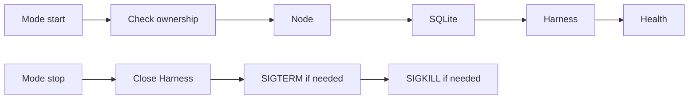

# 02 Node Harness host

## Goal

Rounds starts and stops one Node Host that runs a pi-durable Harness. The Bouncer moves into it, and it is ready to hold Bartenders and Barbacks.

## State

Parts 02a (lifecycle) and 02b (Bouncer) are built. Part 02c has a local container bridge with a restricted tool set. Production registration remains open. See the [container configuration contract](#container-configuration-contract).

Built files and checks are in the [02a walkthrough](02/walkthrough/README.md).

## Depends

Slice 01: the `BouncerAdapter` protocol and the Bouncer Window.

## Builds

- Rounds starts and stops one Node process with pi-durable built from source at the pinned pi commit `5a14e69c067d40dfbff4f2fff7d3b34c897e2dc9`.
- SQLite storage in an approved folder.
- Magpie models.
- The pinned container-use wrapper: a small stdio MCP server with 12 tools, without `environment_checkpoint`, and with `environment_source` pinned to the task repository.
- The Bouncer as a Harness conversation with no tools, and a Rounds protocol between the Bouncer Window and the Node Host: messages, text deltas, tool steps, questions and answers, model list, stop. A durable adapter replaces `PiRPCBouncer`, which this slice deletes with its tests.
- On start, Rounds kills any leftover MCP process group before `resume()`. After a `kill -9` during a tool, the orphaned `container-use stdio` child finished the command.

## Decided

- Decisions "Bouncer on pi-durable", "pi-durable Harness for Bartenders and Barbacks", "Build on unreleased pi-durable" and "Option 3: container-use for all agent work" ([decisions.md](../decisions.md)).
- Build pi-durable in a folder with no symbolic link in its path. Under `/tmp` (a link to `/private/tmp`) TypeScript loads the same file twice and `harness.ts(202,49)` fails with TS2322.
- Preview packages at `pkg.earendil.com` need a login (HTTP 401), so Rounds cannot use them.
- The new database format cannot go back to 1.5.2, so keep no data from earlier probes.
- Evidence for this brief: the pi-durable probe results in [archive/reuse-review.md](../archive/reuse-review.md#pi-durable-checked-2026-11-18), and the container-use, Dagger and egress rows in [archive/feasibility-check.md](../archive/feasibility-check.md).

### Implementation defaults

- *default*: Split this slice into three parts. Each part can merge alone into the feature branch. Lifecycle, conversation migration and tool execution need different checks.
- *default*: 02a builds the process lifecycle only. Keep `PiRPCBouncer` until 02b replaces it. No Harness conversation or scheduling starts in 02a.
- *default*: Store 02a data in `~/Library/Application Support/Rounds/harness/`. Keep the database separate from earlier probes and Bouncer session files.
- *default*: Bundle a local Node executable and the compiled host with the app. Build from the pinned source; do not download preview packages.
- *default*: Packaging builds its own payload. Use `ROUNDS_PI_SOURCE` for a verified local source, or fetch the exact pin into this worktree.
- *default*: Use the first health request as the startup handshake. Save ownership before sending it; input closure ends a launch without a request.
- *default*: Use standard input and output for a versioned, line-based lifecycle protocol. Standard error holds diagnostics only.
- *default*: Check the recorded process birth time, user and run marker before signalling its group. Refuse cleanup when ownership cannot be proved.
- *default*: Leave scheduling paused. Health reads Harness state without creating a conversation, resuming work or calling a model.

## Read first, in full

| File | Read for |
|---|---|
| `AGENTS.md`, `DESIGN.md`, `GLOSSARY.md` | Rules, visual conventions and names |
| This brief and [slices/README.md](README.md) | Scope and build order |
| [decisions.md](../decisions.md) | The four decisions cited under Decided |
| [overview.md](../overview.md), [archive/reuse-review.md](../archive/reuse-review.md) | Structure and source evidence |
| `Sources/RoundsCore/BouncerAdapter.swift`, `Sources/RoundsCore/HarnessBouncer.swift` | Adapter interface and durable Bouncer |
| `Sources/Rounds/BouncerModel.swift`, `Sources/Rounds/RoundsApp.swift` | Start, mode off and quit callers |
| `Package.swift`, `scripts/test.sh`, `scripts/bundle.sh` | Build, tests and app packaging |

Read these files in the pi source at commit `5a14e69c067d40dfbff4f2fff7d3b34c897e2dc9`. Verify its commit before use.

| Pi source file | Contract |
|---|---|
| `packages/durable/README.md` | Harness lifecycle and paused scheduling |
| `packages/durable/src/harness/harness.ts`, `packages/durable/src/harness/types.ts` | `Harness.open`, `inspect`, `close` and options |
| `packages/durable/src/storage/sqlite/node.ts` | `openNodeSqliteStorage` |
| `packages/ai/src/models.ts`, `packages/chord/src/context/index.ts` | `createModels` and `BACKGROUND_CONTEXT` |
| `package.json` and package manifests for telemetry, schema, chord, codemode, ai and durable | Dependency build order and exported paths |

## Files

| Part | Files | Change |
|---|---|---|
| 02a | `Sources/RoundsCore/NodeHarnessHost.swift` | Public actor `NodeHarnessHost`, configuration, health state, process ownership and bounded shutdown |
| 02a | `Resources/harness-host.mjs` | Open the real Harness and SQLite storage; answer health; close on shutdown, input end or termination |
| 02a | `scripts/build-harness-host.sh`, `scripts/bundle.sh` | Build the pinned source in a physical path; package the host and Node |
| 02a | `Sources/Rounds/BouncerModel.swift` | Own the host with Bouncer mode; await health before the existing adapter starts; stop on off and quit |
| 02a | `Tests/RoundsCoreTests/NodeHarnessHostTests.swift` | Lifecycle and ownership regressions with local child fixtures |
| 02a | `docs/spec.md`, this brief, `docs/router-workspace/slices/README.md` | Current behavior and remaining parts |
| 02b | `Sources/RoundsCore/HarnessBouncer.swift`, `Sources/Rounds/BouncerModel.swift`, `Resources/harness-bouncer.mjs`, `Resources/harness-magpie.mjs` | Open, project and control the durable conversation |
| 02c, local | `Resources/harness-container-use.mjs`, `Resources/harness-container-run.mjs`, `Resources/harness-engine-egress.mjs`, `scripts/harness-engine-egress.sh` | Call the pinned server with a verified private run and worker firewall |
| 02c, registration | `Resources/harness-host.mjs` | Add tools when the production requirements pass |

## Container configuration contract

The container-use v0.4.2 tag points to `89ebe7765ec067a07c51de104822056eb217c1b9`. These reads supply configuration independently of the selected source revision.

| Operation | Configuration read in v0.4.2 |
|---|---|
| Create environment | The selected Git ref supplies the source tree. The host source checkout supplies `.container-use/environment.json`. [Creation] and [file loader] |
| Reopen environment | Saved Git notes supply the config and container identity. If saved config is absent, the environment worktree supplies `.container-use/environment.json`. [State lookup] and [reopen] |
| Build a container | A `secrets` entry goes to the Dagger client's secret resolver. The Dagger engine associates the request with the calling client. [Container config] and [client association] |

*Default for the first bridge fixture*: Use a Rounds-owned disposable source checkout with fresh Git metadata and an isolated state directory. Pin the source revision. Keep the checkout and state inaccessible to agents. Use the built-in configuration. Refuse a configuration file or symbolic link at `.container-use/environment.json`, or a linked `.container-use` directory, before a creation request. This keeps the first check independent of repository setup commands, images and secret references.

A selected Git ref does not pin the configuration that the host reads. Keep the validated checkout and state under Rounds control from the check through the upstream read. The bridge supplies the source path and environment identifier. It uses a Rounds-owned local fork and rejects inherited `container-use` remotes or Git notes. [Repository open]

Before any call that loads an existing environment, verify its identifier, source revision and stored state against the run record. Refuse missing, foreign or unverified state before calling the tool. This includes records without config, which otherwise let the upstream loader read the environment worktree. [Tool load]

The local probes used the release source with different markers in the selected revision, host `HEAD` and host working file. The host loader read the working file. The reopen loader used saved configuration when present. With configuration absent from the saved record, it followed a linked directory in the environment worktree. The probes reached the source and state loaders without running Dagger.

The offline fixture runs with `node --test scripts/test-container-admission.mjs`. The host check also runs it with the bundled Node when `ROUNDS_HARNESS_PAYLOAD` is set. Without a payload, the host check reports that it skipped the fixture. It creates temporary Git checkouts, run records and saved-state files. A counted stub records each admitted create or load. The tests cover a clean create, config files and links, missing config or state, identity and revision mismatches, a foreign container identity, and state changes after an allowed load. A create rejects existing remotes and Git notes. A load checks the remote names and URLs, and notes refs and object IDs, against the run record. A modeled create followed by load accepts matching owned metadata. The fixture uses its own JSON state model and a sample built-in config. It does not simulate the fallback worktree read, parse upstream Git notes or exercise container-use.

The fixture accepts empty metadata on load when the run record expects none. It checks `HEAD` and assumes private, stable inputs during each call. Production opens the Harness with an empty tool registry.

### Live upstream checks

A disposable client used container-use v0.4.2 and Dagger v0.18.14 on Docker Desktop for macOS. The probe used a fresh Git repository, an isolated engine, a private image mirror and a test proxy. It started the client with a minimal environment and used a generated secret.

| Check | Observed result |
|---|---|
| Creation and reopen | `Create` saved the built-in config and used the pinned source tree. `Get` read `refs/notes/container-use-state` and preferred saved config over a linked `.container-use` directory. Removing only `config` from the note made `Get` read through the link. Removing the note made `Get` fail before fallback. |
| Private checkout and state | The owner, device, inode and permissions of the tracked paths stayed stable through `Get` and `Run`. The checkout and state roots used mode `0700`. The source revision, local fork remote, worktree revision and note identity stayed stable. The guest could read a source file and could see neither the private host root nor `.git`. |
| Secret resolution | A host working config resolved an `env://` value through the Dagger client. `Create` failed with the same config when the next client lacked the value. The probe printed only success markers. |
| Network, internal Docker network alone | `Run` received the proxy settings. The allowed proxy route reached the test origin, and the denied route returned status `403`. Direct connections to the test origin and a public address failed. The public name lookup failed. Both the original command and a nested Dagger worker could connect directly to the private image mirror. |
| Network, with worker firewall | The firewall allowed worker traffic to the proxy address and port. It blocked other traffic from the worker bridge. Both workers lost direct access to the mirror. The proxy allow and deny checks still passed. |
| Network after restart | The engine restart cleared the firewall. Installing the forwarding rules before the first job let Dagger's network setup put its accept rules first. Both workers could reach the mirror again. A second restart with a filter before the forwarding stage blocked both paths and preserved the proxy checks. |
| Reopen after restart | `Update` persisted a file marker and the probe saved an owned run record. A fresh client read the marker after an engine restart and on a fresh engine with a new volume. The probe's preflight rejected a dirty source checkout and a changed note. |

### Local bridge

| Boundary | Behavior |
|---|---|
| Checkout and state | The bridge imports a pinned revision into a fresh private repository. A lock holds through preflight, the upstream call and readback. The ownership record binds the checkout, fork, worktree, saved Git note, container identity and configuration. |
| Restart | A fresh client reopens recorded state after verification. A failed engine check before dispatch releases the lock. An outstanding lock from an uncertain call blocks reopen. |
| Transport | The bridge starts the pinned server with a private home and a fixed local engine. It supplies the source, revision and environment identity. Requests and replies have size and time limits. |
| Tools | A run can create or open one environment, update its title and read, list, write, edit or delete files. The bridge permits only the built-in container config. |
| Commands | A trusted host can opt in to foreground commands with the patched client. The bridge binds the source and environment and accepts only the command and optional explanation. The reply gives the exit status after the client saves the result. |
| Engine | The startup script writes the capability policy and installs worker rules before Dagger starts. The bridge checks the startup script, policy and worker rules against each engine start. An engine restart during a call invalidates its response. |

Run `scripts/build-container-use.sh` with Go 1.24.3 or later to build the private client from the pinned source. The patch disables Dagger nesting for foreground execution and sets a distinct server version. The bridge checks that version before it sends a tool call. After a version refusal, it verifies the existing run before it releases the lock. The stock [command handler] enables nesting, which lets a nested [HTTP request] run beyond the worker firewall.

The client removes skipped untracked build files from the private Git worktree after staging. Those files stay in the saved container state. A nonzero exit status gives a failed tool reply and preserves the saved result.

The disposable restart check reopened a command result and a skipped build file after the engine restarted. The worker reached the allowed proxy route. It could not reach the denied route, the origin directly or the image mirror directly. The bridge also refused a dirty checkout, a changed startup script and a missing firewall rule in the preceding restart check.

### Production registration gates

- Verify the production proxy allowlist and direct mirror denial with the foreground worker.
- Reconcile stored runs with the Harness database and verified process identities before scheduling resumes. A run with an outstanding lock requires verified recovery before it can reopen.
- Define the policy for the remaining tools and for saved configuration changes. The local bridge uses the built-in config and a single verified environment.

[command handler]: https://github.com/dagger/container-use/blob/89ebe7765ec067a07c51de104822056eb217c1b9/environment/environment.go#L235-L245
[HTTP request]: https://github.com/dagger/dagger/blob/v0.18.14/core/http.go#L72

[Creation]: https://github.com/dagger/container-use/blob/89ebe7765ec067a07c51de104822056eb217c1b9/repository/repository.go#L185-L239
[file loader]: https://github.com/dagger/container-use/blob/89ebe7765ec067a07c51de104822056eb217c1b9/environment/config.go#L146-L160
[State lookup]: https://github.com/dagger/container-use/blob/89ebe7765ec067a07c51de104822056eb217c1b9/repository/git.go#L323-L340
[reopen]: https://github.com/dagger/container-use/blob/89ebe7765ec067a07c51de104822056eb217c1b9/environment/environment.go#L90-L110
[Container config]: https://github.com/dagger/container-use/blob/89ebe7765ec067a07c51de104822056eb217c1b9/environment/environment.go#L131-L151
[client association]: https://github.com/dagger/dagger/blob/v0.18.14/core/schema/secret.go#L66-L98
[Repository open]: https://github.com/dagger/container-use/blob/89ebe7765ec067a07c51de104822056eb217c1b9/repository/repository.go#L78-L118
[Tool load]: https://github.com/dagger/container-use/blob/89ebe7765ec067a07c51de104822056eb217c1b9/mcpserver/tools.go#L59-L97

## Lifecycle contract

| Boundary | Contract |
|---|---|
| Swift owner | `NodeHarnessHost.start() async throws -> HarnessHostHealth` starts at most one host. `health() async throws -> HarnessHostHealth` checks it. `stop() async throws` waits for cleanup. |
| Configuration | Absolute Node, host script and data folder URLs. Production uses the app bundle and the Rounds application support folder. Tests supply temporary paths. |
| Protocol | One JSON object per line, protocol `1`, matching string `id` and `command`. Lifecycle commands are `health` and `shutdown`. Health returns `ok`, pinned `commit` and `scheduling`. |
| Harness | Open the Harness with an empty registry. Health calls `inspect`. Shutdown calls `close`. Scheduling starts only when the conversation needs work. |
| Storage | `harness.sqlite` under the configured folder. A per-folder lock rejects a second owner. An atomic process record supports cleanup after an abrupt parent exit. |
| Process group | Create a fresh group before the host executes. Record its leader, birth time and argument marker. Validate live members and save newly verified descendant births before shutdown and before each group signal. If a record write fails, continue verified cleanup with the in-memory record and report the write failure. |
| Failure | Startup, invalid health, timeout, early exit and unsafe cleanup throw a clear error. Keep a record when cleanup fails. Never resume work after failed cleanup. |
| App | Mode off, quit and Pi launch failure await host cleanup. A mode toggle waits for the previous shutdown. Host errors stay pending until the Bouncer window can show the banner. Demo mode uses no host. |

## How it works

| Step | Behavior |
|---|---|
| Build | Fetch the exact commit into a fresh bare Git repository with replacement refs disabled. Export its tracked files and generate model data with the pinned generator. Use a physical path for dependency installation and compilation. Release and beta build the host with standalone arm64 Node in a separate job with no signing or tap secrets. |
| Start | Create the data folder and acquire its lock. Check and clean a recorded leftover group before starting a new host. |
| Launch | Spawn Node in its own process group, with pipes and an argument marker. Save the record before the first health request. Input closure exits an interrupted launch. |
| Ready | Open SQLite, then open the Harness. Return health only after both succeed. Swift checks the protocol version, request identity, source commit and paused state. |
| Running | Keep one host for this mode lifetime. Health reports real Harness inspection. The Bouncer shares the host pipes with lifecycle commands. |
| Stop | Ask for shutdown and close input. Wait for graceful exit, then send `SIGTERM`, then `SIGKILL` after bounded waits. Reap the child and check group members. |
| Restart | Clean the verified recorded group. If a recorded child is still live outside the group, keep the record and block startup. Retry after the child exits. |

## Bouncer contract

| Boundary | Contract |
|---|---|
| Requests | `bouncerOpen`, `bouncerSend`, `bouncerStop`, `bouncerAnswer` and `bouncerModel` use the lifecycle envelope. A command error returns `ok: false` and an error. For `bouncerSend` and `bouncerAnswer`, `rejected: true` confirms validation failed before submission. A missing or invalid reply after a full request, or an error without confirmed rejection, leaves the outcome unknown. Rounds closes the host so Start Again can replay the conversation. |
| Events | The host sends conversation events on separate lines. Message entries, text deltas, model choices, questions and answers share the stream with command replies. The protocol accepts tool-step events for later slices. The Bouncer offers no tools. |
| Questions | A complete, valid `ROUNDS_QUESTION` reply becomes a question card. SQLite stores the question in the assistant entry. An answer entry refers to that question. Dismiss writes an answer entry without calling Magpie. |
| Recovery | Reload committed entries and the saved model from the reserved root. Mark unfinished work before the scheduler starts. Report the interruption. Accept conversation commands only after recovery and replay succeed. |
| Model configuration | Read Pi `models.json` and `settings.json`, using only the Magpie provider. Support literal keys and headers. An explicit selection persists in SQLite. |
| Fixture | Set `ROUNDS_HARNESS_PAYLOAD` to the built host folder and `ROUNDS_HARNESS_SCRATCH` to a temporary folder. Run `scripts/test.sh` to include the bundled conversation and lifecycle fixtures. The loopback provider exercises the `openai-completions`, `openai-responses` and `anthropic-messages` routes. |

## Tests

| Case | Observable result |
|---|---|
| Start twice | One child and one healthy host; the second start does not spawn another child |
| Health | The matching response has protocol 1, the pinned commit and paused scheduling |
| Bad health or early exit | Startup fails and its child is reaped; a later clean start can proceed |
| Silent host | Startup times out within its bound and cleans its group |
| Cooperative stop | The host receives shutdown, exits, and leaves no child or active group member |
| Ignore shutdown and termination | Stop escalates to `SIGKILL` and removes a same-group child too |
| Child first seen during shutdown | Stop verifies and removes a stubborn child after the leader exits |
| Pi launch failure | Rounds shuts down the already running host |
| Host shutdown notice | The notice stays pending across Pi start and exit while the Bouncer window is hidden |
| Leftover group | A replacement cleans the recorded group before launching its new host |
| Identity mismatch | Cleanup refuses to signal an unrelated live process and preserves the record |
| Two owners | The folder lock rejects the second owner without stopping the first |
| Released failed owner | The record remains, but releasing the actor closes its lock; a new owner can read a corrected record |
| Exited child or closed input | Start Again starts a healthy replacement on its first attempt |
| Absent process record | Verified stop succeeds and a later start acquires the folder |
| Real Harness | With a scratch data folder, start the built host, inspect paused state, stop it and check that no Node child remains |
| Regression proof | Temporarily remove one behavior. Its focused test must fail through `scripts/test.sh`. Restore it before final checks. |

## Numbers

| Measure | Target |
|---|---|
| Host count | At most 1 per Rounds data folder |
| Protocol version | 1 |
| Maximum request or response line | 65,536 bytes |
| Transcript replay deadline | 10 seconds without an event, 60 seconds total |
| Health deadline | 10 seconds |
| Shutdown waits | 2 seconds graceful, 2 seconds after termination, 2 seconds after forced termination |
| Poll interval | 20 milliseconds |
| Pinned pi commit | `5a14e69c067d40dfbff4f2fff7d3b34c897e2dc9` |
| Automated acceptance | All tests through `scripts/test.sh`, full build and `git diff --check` pass |
| Live acceptance | One real Harness health response; no model request; no live Node descendant after stop |

## Carried

| Part | Remaining work | Takes it |
|---|---|---|
| 02c | Pinned container tool bridge and its unresolved requirements | Slice 02c |

## Review round 1

| Finding | Action |
|---|---|
| Failed cleanup could leave a raw folder lock open after actor release | Close the descriptor in actor destruction; test a new owner after failure |
| Start Again could need two attempts after a child exit | Reap before reuse; replace a host whose output closed; test the first retry |
| A crash before record persistence could leave a suspended child | Remove suspended spawn; wait for health before opening storage; close on input end |
| Packaging required an ignored payload that clean builds did not prepare | Make packaging build the exact source pin, with a local source override |

## Review round 2

| Finding | Action |
|---|---|
| A child could close input between the reap check and the health write | Map broken-pipe writes to an exited host; test replacement on the same start call |
| Failed record persistence could make later cleanup require an absent file | Clear an absent record after verified termination; test stop and restart |
| Full-suite concurrency exposed delayed lock release | Explicitly unlock before closing the descriptor; the final full suite passes |

The main review checked both new failure paths and their regression tests.

## Independent review

| Finding | Action |
|---|---|
| Dependency builds received signing and tap credentials | Run the host build in a separate job and download its artifact by ID with digest checks |
| Intel-only Node could pass on Apple silicon under Rosetta | Pin standalone arm64 Node in the workflow and execute the runtime checks in arm64 mode |
| Local replacement refs and ignored model data changed the pinned build | Export the pinned Git objects from a fresh repository and regenerate model data |
| A child first seen during shutdown could survive its leader | Save verified child identities before signalling and keep verified cleanup active if a record write fails |
| Pi launch failure could leave the host running | Stop the host on launch error or Pi exit before its initial state |
| Pi restart or exit could erase an unseen host notice | Retain the notice until the visible banner view receives it |

## Open

- Check the live Magpie service before release. The conversation fixture uses a loopback provider.
- Define restart behavior for model requests made by Bartenders and Barbacks. The Bouncer aborts interrupted requests before it resumes scheduling.
- The shared engine version must match the container-use release. Keep nesting disabled for admitted tools on that engine.
- Choose the one egress allowlist for version one. An allowed domain can still receive data from the container. Use an IP address for the proxy. The engine DNS did not resolve Docker aliases in the earlier feasibility probe.
- Complete the [production registration gates](#production-registration-gates) before adding tools to the Harness registry.
- Account for descendants that detach before Rounds records their birth identity. A recorded child that detaches blocks startup until it exits.
