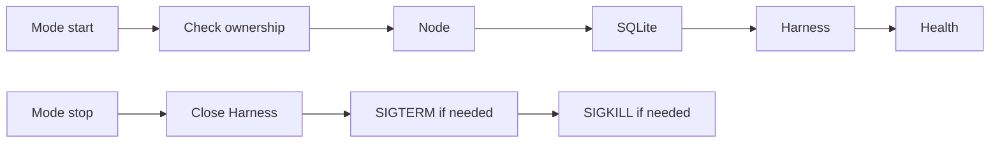

# 02 Node Harness host

## Goal

Rounds starts and stops one Node Host that runs a pi-durable Harness. The Bouncer moves into it, and it is ready to hold Bartenders and Barbacks.

## State

Details, 2026-11-22. Built: 02a lifecycle. The items under Open remain open. Parts 02b and 02c remain planned.

Built files and checks are in the [02a walkthrough](02/walkthrough/README.md).

## Depends

Slice 01: the `BouncerAdapter` protocol and the Bouncer Window.

## Builds

- Rounds starts and stops one Node process with pi-durable built from source at the pinned pi commit `5a14e69c067d40dfbff4f2fff7d3b34c897e2dc9`.
- SQLite storage in an approved folder.
- Magpie models.
- The pinned container-use wrapper: a small stdio MCP server with 12 tools, without `environment_checkpoint`, and with `environment_source` pinned to the task repository.
- The Bouncer as a Harness conversation with no tools, and a Rounds protocol between the Bouncer Window and the Node Host: messages, text deltas, tool steps, questions and answers, model list, stop. A durable adapter replaces `PiRPCBouncer`, which this slice deletes with its tests.
- On start, Rounds kills any leftover MCP process group before `resume()`. After a `kill -9` during a tool, the orphaned `container-use stdio` child finished the command.

## Decided

- Decisions "Bouncer on pi-durable", "pi-durable Harness for Bartenders and Barbacks", "Build on unreleased pi-durable" and "Option 3: container-use for all agent work" ([decisions.md](../decisions.md)).
- Build pi-durable in a folder with no symbolic link in its path. Under `/tmp` (a link to `/private/tmp`) TypeScript loads the same file twice and `harness.ts(202,49)` fails with TS2322.
- Preview packages at `pkg.earendil.com` need a login (HTTP 401), so Rounds cannot use them.
- The new database format cannot go back to 1.5.2, so keep no data from earlier probes.
- Evidence for this brief: the pi-durable probe results in [archive/reuse-review.md](../archive/reuse-review.md#pi-durable-checked-2026-11-18), and the container-use, Dagger and egress rows in [archive/feasibility-check.md](../archive/feasibility-check.md).

### Implementation defaults

- *default*: Split this slice into three parts. Each part can merge alone into the feature branch. Lifecycle, conversation migration and tool execution need different checks.
- *default*: 02a builds the process lifecycle only. Keep `PiRPCBouncer` until 02b replaces it. No Harness conversation or scheduling starts in 02a.
- *default*: Store 02a data in `~/Library/Application Support/Rounds/harness/`. Keep the database separate from earlier probes and Bouncer session files.
- *default*: Bundle a local Node executable and the compiled host with the app. Build from the pinned source; do not download preview packages.
- *default*: Packaging builds its own payload. Use `ROUNDS_PI_SOURCE` for a verified local source, or fetch the exact pin into this worktree.
- *default*: Use the first health request as the startup handshake. Save ownership before sending it; input closure ends a launch without a request.
- *default*: Use standard input and output for a versioned, line-based lifecycle protocol. Standard error holds diagnostics only.
- *default*: Check the recorded process birth time, user and run marker before signalling its group. Refuse cleanup when ownership cannot be proved.
- *default*: Leave scheduling paused. Health reads Harness state without creating a conversation, resuming work or calling a model.

## Read first, in full

| File | Read for |
|---|---|
| `AGENTS.md`, `DESIGN.md`, `GLOSSARY.md` | Rules, visual conventions and names |
| This brief and [slices/README.md](README.md) | Scope and build order |
| [decisions.md](../decisions.md) | The four decisions cited under Decided |
| [overview.md](../overview.md), [archive/reuse-review.md](../archive/reuse-review.md) | Structure and source evidence |
| `Sources/RoundsCore/BouncerAdapter.swift` | `BouncerAdapter` and `PiRPCBouncer` |
| `Sources/Rounds/BouncerModel.swift`, `Sources/Rounds/RoundsApp.swift` | Start, mode off and quit callers |
| `Package.swift`, `scripts/test.sh`, `scripts/bundle.sh` | Build, tests and app packaging |

Read these files in the pi source at commit `5a14e69c067d40dfbff4f2fff7d3b34c897e2dc9`. Verify its commit before use.

| Pi source file | Contract |
|---|---|
| `packages/durable/README.md` | Harness lifecycle and paused scheduling |
| `packages/durable/src/harness/harness.ts`, `packages/durable/src/harness/types.ts` | `Harness.open`, `inspect`, `close` and options |
| `packages/durable/src/storage/sqlite/node.ts` | `openNodeSqliteStorage` |
| `packages/ai/src/models.ts`, `packages/chord/src/context/index.ts` | `createModels` and `BACKGROUND_CONTEXT` |
| `package.json` and package manifests for telemetry, schema, chord, codemode, ai and durable | Dependency build order and exported paths |

## Files

| Part | Files | Change |
|---|---|---|
| 02a | `Sources/RoundsCore/NodeHarnessHost.swift` | Public actor `NodeHarnessHost`, configuration, health state, process ownership and bounded shutdown |
| 02a | `Resources/harness-host.mjs` | Open the real Harness and SQLite storage; answer health; close on shutdown, input end or termination |
| 02a | `scripts/build-harness-host.sh`, `scripts/bundle.sh` | Build the pinned source in a physical path; package the host and Node |
| 02a | `Sources/Rounds/BouncerModel.swift` | Own the host with Bouncer mode; await health before the existing adapter starts; stop on off and quit |
| 02a | `Tests/RoundsCoreTests/NodeHarnessHostTests.swift` | Lifecycle and ownership regressions with local child fixtures |
| 02a | `docs/spec.md`, this brief, `docs/router-workspace/slices/README.md` | Current behavior and remaining parts |
| 02b | `Sources/RoundsCore/BouncerAdapter.swift`, `Sources/Rounds/BouncerModel.swift`, `Tests/RoundsCoreTests/BouncerTests.swift`, `Tests/RoundsCoreTests/PiRPCTests.swift`, `Resources/harness-host.mjs` | Replace the adapter with Harness conversation messages; remove the obsolete adapter and its tests |
| 02c | `Resources/harness-host.mjs` and a new adjacent container tool wrapper | Add the pinned container tool bridge after its open requirements are settled |

## Contracts

| Boundary | 02a contract |
|---|---|
| Swift owner | `NodeHarnessHost.start() async throws -> HarnessHostHealth` starts at most one host. `health() async throws -> HarnessHostHealth` checks it. `stop() async throws` waits for cleanup. |
| Configuration | Absolute Node, host script and data folder URLs. Production uses the app bundle and the Rounds application support folder. Tests supply temporary paths. |
| Protocol | One JSON object per line, protocol `1`, matching string `id` and `command`. Commands are `health` and `shutdown`. Health returns `ok`, pinned `commit` and `scheduling`. |
| Harness | `Harness.open(storage, {models: createModels(), registry: createRegistry()}, BACKGROUND_CONTEXT)`. Health calls `inspect`. Shutdown calls `close`. No `root`, `submit` or `resume`. |
| Storage | `harness.sqlite` under the configured folder. A per-folder lock rejects a second owner. An atomic process record supports cleanup after an abrupt parent exit. |
| Process group | Create a fresh group before the host executes. Record its leader, birth time and argument marker. Record observed descendant births after health. Validate live members before each group signal. |
| Failure | Startup, invalid health, timeout, early exit and unsafe cleanup throw a clear error. Keep a record when cleanup fails. Never resume work after failed cleanup. |
| App | Mode off and quit await host cleanup. A mode toggle cannot start a replacement before the previous shutdown ends. Demo mode uses no host. |

## How it works

| Step | Behavior |
|---|---|
| Build | Verify the source commit. Export it into this worktree's ignored build folder. Use `cd -P` before dependency installation and compilation. Build the required packages, then bundle the host. |
| Start | Create the data folder and acquire its lock. Check and clean a recorded leftover group before starting a new host. |
| Launch | Spawn Node in its own process group, with pipes and an argument marker. Save the record before the first health request. Input closure exits an interrupted launch. |
| Ready | Open SQLite, then open the Harness. Return health only after both succeed. Swift checks the protocol version, request identity, source commit and paused state. |
| Running | Keep one host for this mode lifetime. Health reports real Harness inspection. Keep the existing Bouncer adapter separate until 02b. |
| Stop | Ask for shutdown and close input. Wait for graceful exit, then send `SIGTERM`, then `SIGKILL` after bounded waits. Reap the child and check group members. |
| Restart | Clean only the verified recorded group. A mismatched process identity blocks startup. Detached descendants and work reconciliation remain Open. |

## Tests

| Case | Observable result |
|---|---|
| Start twice | One child and one healthy host; the second start does not spawn another child |
| Health | The matching response has protocol 1, the pinned commit and paused scheduling |
| Bad health or early exit | Startup fails and its child is reaped; a later clean start can proceed |
| Silent host | Startup times out within its bound and cleans its group |
| Cooperative stop | The host receives shutdown, exits, and leaves no child or active group member |
| Ignore shutdown and termination | Stop escalates to `SIGKILL` and removes a same-group child too |
| Leftover group | A replacement cleans the recorded group before launching its new host |
| Identity mismatch | Cleanup refuses to signal an unrelated live process and preserves the record |
| Two owners | The folder lock rejects the second owner without stopping the first |
| Released failed owner | The record remains, but releasing the actor closes its lock; a new owner can read a corrected record |
| Exited child or closed input | Start Again starts a healthy replacement on its first attempt |
| Absent process record | Verified stop succeeds and a later start acquires the folder |
| Real Harness | With a scratch data folder, start the built host, inspect paused state, stop it and check that no Node child remains |
| Regression proof | Temporarily remove one behavior. Its focused test must fail through `scripts/test.sh`. Restore it before final checks. |

## Numbers

| Measure | Target |
|---|---|
| Host count | At most 1 per Rounds data folder |
| Protocol version | 1 |
| Maximum response line | 65,536 bytes |
| Health deadline | 10 seconds |
| Shutdown waits | 2 seconds graceful, 2 seconds after termination, 2 seconds after forced termination |
| Poll interval | 20 milliseconds |
| Pinned pi commit | `5a14e69c067d40dfbff4f2fff7d3b34c897e2dc9` |
| Automated acceptance | All tests through `scripts/test.sh`, full build and `git diff --check` pass |
| Live acceptance | One real Harness health response; no model request; no live Node descendant after stop |

## Carried

| Part | Remaining work | Takes it |
|---|---|---|
| 02b | Model resolution, Bouncer conversation protocol and removal of `PiRPCBouncer` | Slice 02b |
| 02c | Pinned container tool bridge and its unresolved requirements | Slice 02c |

## Review round 1

| Finding | Action |
|---|---|
| Failed cleanup could leave a raw folder lock open after actor release | Close the descriptor in actor destruction; test a new owner after failure |
| Start Again could need two attempts after a child exit | Reap before reuse; replace a host whose output closed; test the first retry |
| A crash before record persistence could leave a suspended child | Remove suspended spawn; wait for health before opening storage; close on input end |
| Packaging required an ignored payload that clean builds did not prepare | Make packaging build the exact source pin, with a local source override |

## Review round 2

| Finding | Action |
|---|---|
| A child could close input between the reap check and the health write | Map broken-pipe writes to an exited host; test replacement on the same start call |
| Failed record persistence could make later cleanup require an absent file | Clear an absent record after verified termination; test stop and restart |
| Full-suite concurrency exposed delayed lock release | Explicitly unlock before closing the descriptor; the final full suite passes |

The main review checked both new failure paths and their regression tests. No finding remains in 02a.

## Open

- Magpie models that do not use `openAICompletionsApi` were not tested in the Harness. Resolve the selected model and protocol at launch.
- A `kill -9` during a model request sends the request again on resume, so the provider can bill it twice.
- The shared engine version must match the container-use release. Nesting still lets code in a container start normal containers on that engine.
- Choose the one egress allowlist for version one. An allowed domain can still receive data from the container. The proxy address must be an IP address, because the engine DNS does not resolve Docker aliases.
- Check whether secret references in a repository's `.container-use/environment.json` resolve on the host when an environment starts from an agent branch.
- Verify the identity of a process before Rounds signals it. A detached descendant can escape process-group cleanup.
- After a restart, reconcile run identity, process state, checkout ownership and local-only records before work resumes.
