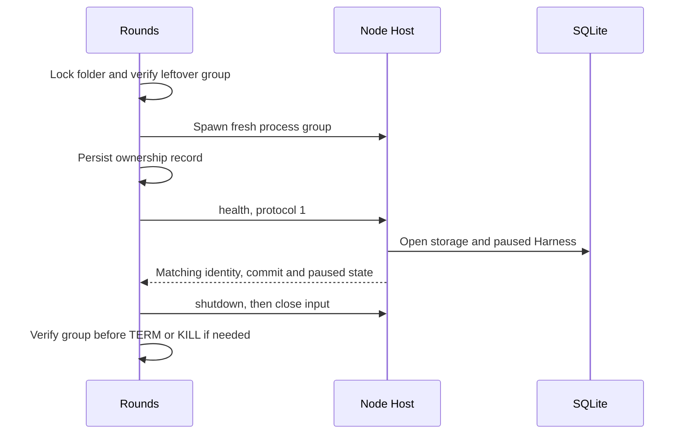

# Slice 02a walkthrough

| File | Lines | Bytes |
|---|---:|---:|
| `Sources/RoundsCore/NodeHarnessHost.swift` | 389 | 17,521 |
| `Resources/harness-host.mjs` | 72 | 3,214 |
| `Sources/Rounds/BouncerModel.swift` | 248 | 11,136 |
| `scripts/build-harness-host.sh` | 42 | 1,903 |
| `scripts/bundle.sh` | 32 | 1,746 |
| `Tests/RoundsCoreTests/NodeHarnessHostTests.swift` | 253 | 10,852 |

## Boundary

Only the Node Host lifecycle is built. The existing Bouncer adapter remains until 02b. Tools remain in 02c.



The first health request gates storage opening. Input closure before that request ends an interrupted launch.

The actor checks kernel birth identity, user, group and the leader argument marker before signalling. Health records observed descendant births.

Recorded descendants can be verified after leader exit. Unknown descendants without a verified parent chain block cleanup. Detached descendants remain Open.

## Build and validation

`--filter` selects a named test. `ROUNDS_PI_SOURCE` supplies a local source; without it, packaging fetches the exact pin.

```sh
scripts/test.sh
scripts/test.sh --filter harnessHostRejectsWrongHealthIdentity
ROUNDS_PI_SOURCE=/absolute/path/to/pi scripts/bundle.sh
git diff --check
```

| Check | Result |
|---|---|
| Source | Verified `5a14e69c067d40dfbff4f2fff7d3b34c897e2dc9`; local and fresh-fetch builds pass |
| Full suite | 365 tests pass; the conditional live check is skipped in that run |
| Known flaky tests | Both named cases pass; neither needed a rerun |
| Mutation | Removing response identity validation fails its test; validation was restored before the full suite |
| Real Harness | A scratch database opens; health reports paused; stop reaps Node and leaves no live group member |
| Packaging | Release build and local app packaging pass; no install or app launch |
| Remaining checks | Model calls, conversation migration, tool execution and detached descendants are outside 02a |

The source install warns about an unused workspace engine requirement. The six required packages build with the bundled Node 25.9.0.

Review findings and carried work are in the [slice brief](../../02-node-harness-host.md). The original Open items remain unchanged.
