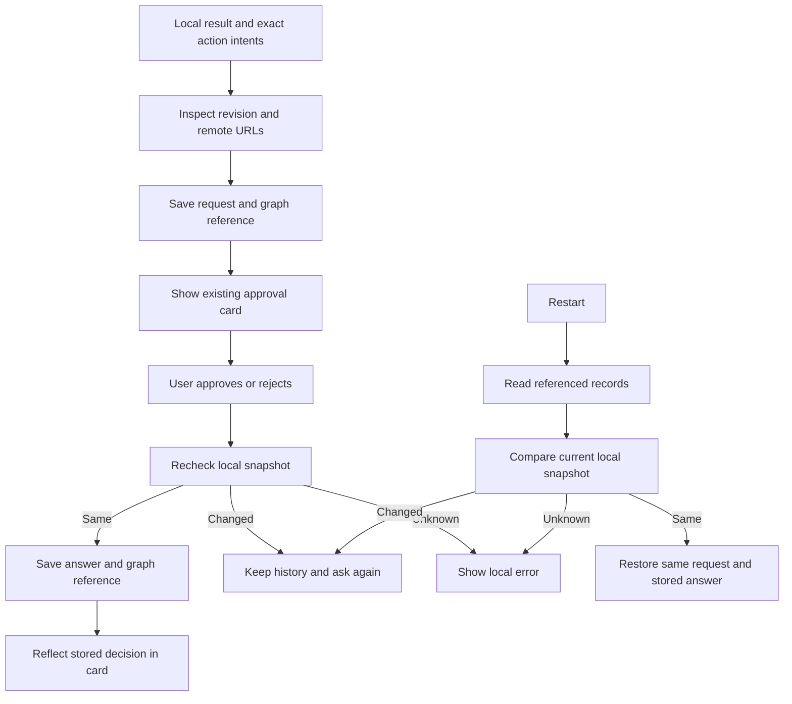

# 04 Approval gate and publication

## Goal

Rounds pushes a branch or opens a draft pull request for a result only after the user approves the exact list of actions. Agents cannot do a protected action.

## State

Details, 2026-11-22. The 04a code uses the integrated 01c cards and 03 local task interface. An authorized test fixture supplies a local result. The app has no caller for `showLocalApprovals`. Slice 03 dispatch and task mapping must supply real task identifiers, organization scope and fresh graph and detail grants. Workspace folder setup supplies readiness, not those grants. Until then, the app cannot discover or display saved local approvals. See Open for the later steps.

## Depends

[Slice 01c](01-bouncer-mode.md) and the local task interface from [slice 03](03-dispatch-and-results.md). Sub-step 04a can merge before dispatch exists, with local fixtures. Sub-step 04b also needs the [slice 02 Node Host](02-node-harness-host.md).

## Read first, in full

| Read | Reason |
|---|---|
| [AGENTS.md](../../../AGENTS.md), [DESIGN.md](../../../DESIGN.md), [GLOSSARY.md](../../../GLOSSARY.md) | Change rules, existing controls and state words. |
| [Spec 2.7](../../spec.md#27-pi-sessions), including 2.7.1 and 2.7.2; [spec 5.9](../../spec.md#59-bouncer-window) | Session identity, organization rules, authorized storage and the Bouncer Window. |
| This brief; [03](03-dispatch-and-results.md); [01](01-bouncer-mode.md); [slice index](README.md) | Approval scope, result identity and existing card contracts. |
| [Decisions](../decisions.md) | Read the complete entries named under Decided. |
| [Context](../CONTEXT.md); [archived Bouncer review](../archive/bouncer-review.md) | Authority chain and proposals that remain open. |
| [Bouncer.swift](../../../Sources/RoundsCore/Bouncer.swift), [BouncerModel.swift](../../../Sources/Rounds/BouncerModel.swift), [BouncerWindow.swift](../../../Sources/Rounds/BouncerWindow.swift) | Current approval types and adapter boundary. |
| [BouncerCards.swift](../../../Sources/Rounds/BouncerCards.swift) | The existing card, its callback and the local result display. |
| [TaskDetailStore.swift](../../../Sources/RoundsCore/TaskDetailStore.swift), [TaskRecordStore.swift](../../../Sources/RoundsCore/TaskRecordStore.swift), [Workspace.swift](../../../Sources/RoundsCore/Workspace.swift) | Immutable records, graph references and local repository inspection. |
| `living-docs/SKILL.md`, section "Slice brief" | Read from `vps:~/.local/share/magpie/shared-skills/skills/living-docs/SKILL.md`. |
| Pi source at `5a14e69c067d40dfbff4f2fff7d3b34c897e2dc9` | Read `packages/durable/test/examples/44-approval-gate.ts`, `packages/durable/src/signals.ts`, and the `signal` definitions in `packages/durable/src/harness/{types,harness}.ts`. |

Verify the Pi source revision before using its contracts. The example uses memory storage and an in-memory question map. It proves the gate sequence, not request persistence or action authority.

## Builds

Each row is a separate merge. Merge 04a first; 04b adds no publication capability. Detail 04c only after its blockers are resolved.

| Sub-step | Scope | Why it merges alone |
|---|---|---|
| 04a: local approval records | Store a request and answer; recheck the local revision and remote URL after restart; connect card decisions to stored answers. | Local repository fixtures prove storage and rechecks. App registration awaits real task context and storage grants. No container, model or network is needed for the fixtures. |
| 04b: durable gate connection | Connect stored requests and answers to a sleeping Pi task, using an inert test tool and a fake provider. | Proves persistence and signal recovery independently of the publication guard. No agent dispatch or protected tool is enabled. |
| 04c: publication | **not detailed; blocked by Open item 1**. Barback requests also depend on Open item 2. | A later merge can add publication only after ownership, recovery, review and the complete guard are specified and verified. |

No sub-step detailed here runs a real push or creates a real pull request. Sub-step 04c has no executor, command recipe or live acceptance test in this brief.

## Files

These are implementation locations for later work. This details step changes documentation only.

| Sub-step | File | Change |
|---|---|---|
| 04a | `Sources/RoundsCore/Approval.swift` (new) | Typed request, answer, local snapshot comparison and state transitions. No executor. |
| 04a | [TaskDetailStore.swift](../../../Sources/RoundsCore/TaskDetailStore.swift), [TaskRecordStore.swift](../../../Sources/RoundsCore/TaskRecordStore.swift), `Sources/RoundsCore/TaskInterface.swift` (03 prerequisite) | Add approval records to immutable detail revisions. Carry them through every existing write caller and the task interface's storage authorization. |
| 04a | [Workspace.swift](../../../Sources/RoundsCore/Workspace.swift) | Extend the local inspector to resolve the result's named source reference to its full commit revision. Reuse remote inspection. |
| 04a | [Bouncer.swift](../../../Sources/RoundsCore/Bouncer.swift), [BouncerModel.swift](../../../Sources/Rounds/BouncerModel.swift), [BouncerWindow.swift](../../../Sources/Rounds/BouncerWindow.swift) | Project records into cards. Save before updating a card's decision. |
| 04a | `Sources/Rounds/BouncerCards.swift` (01c prerequisite) | Reuse its decision callback and rejection reason. Select the card copy from host provenance. |
| 04a | [TaskInterfaceTests.swift](../../../Tests/RoundsCoreTests/TaskInterfaceTests.swift), [TaskDetailStoreTests.swift](../../../Tests/RoundsCoreTests/TaskDetailStoreTests.swift) | Exercise approval boundaries, saved answers, stale records and old checksums in the existing Swift test target. |
| 04b | Node Host source and test files established by slice 02 | Add the gate and local approval messages there. Set exact paths in slice 02 before implementation; do not create another host or database. |
| 04a, 04b | [Spec](../../spec.md#59-bouncer-window), this brief and [slice index](README.md) | Update current behavior when each implementation merges. Keep future publication marked as blocked. |
| 04c | None selected | Publication files await the complete guard. |

## Contracts

### Local request and answer

The local store uses these record types. The gate and delivery fields belong to 04b.

| Record | Required contents and rule |
|---|---|
| `ApprovalRequest` | A host-created request identifier; task, repository and organization identities; result detail revision; source reference and full commit revision; creation and check times. |
| Requested actions | A nonempty ordered list with unique action identifiers, action kind, exact target and the local result being proposed. Accept only push and draft pull request intents. |
| Push intent | Source reference and exact Git object identifier, selected remote, effective addresses with user information removed, and exact destination reference. These values support display and comparison. |
| Draft pull request intent | Provider repository, base and head references, head revision, draft status, and an immutable reference to the proposed title and body. No provider call. |
| Local snapshot | Repository folder path, device and inode. Include the named source reference, resolved commit and distinct tag object if present. Include the selected remote, complete effective remote list and branch push overrides. |
| `ApprovalAnswer` | Request identifier, `ApprovalDecision`, user actor and answer time. A rejection requires a reason after whitespace trimming. The first stored answer is final. |
| Gate binding, added in 04b | Durable task identifier, signal name, signal version and signal key. One request maps to one task and one key. Agents cannot supply or replace this binding. |
| Delivery, added in 04b | Record whether the stored answer still needs delivery, was durably accepted, or needs inspection. Delivery is separate from the answer and action outcome. |

Use the request identifier as `ApprovalCard.id`; keep `ApprovalCard.taskID` tied to its task. Build `actions: [String]` from the typed intents in order. Those strings are presentation, never command input or an authority token.

The host supplies the record type to the card. Use these labels for the demo and for a saved local request, including after reload:

| Card | Check and scope | Approval | Rejection |
|---|---|---|---|
| Demo | `Demo check: <time>. No action will run.` | `Approved in this demo` | `Rejected: <reason>` |
| Saved local request | `Local check at <time>. Rounds saves your decision on this Mac. No action will run.` | `Approval saved locally` | `Rejection saved locally: <reason>` |

Show a saved decision only after the detail and graph reference are durable. The saved labels describe what Rounds recorded. They grant no authority to execute an action.

Store the records in the task's authorized detail revisions. Write the detail before changing its graph reference, as `TaskRecordStore` does. Extend the detail format explicitly; old revisions decode with no approval records. Verify old checksums against their original format before adding empty approval fields. Unknown formats still fail.

Keep the request's original result revision separate from the current detail revision used for storage. Approval, delivery and progress writes create new detail revisions without changing that result. Compare the original result with the current `TaskResult`; those storage writes alone must not make the request stale.

A result must carry the repository identifier and folder identity supplied by its authorized producer. The request must match both. An older result without this binding cannot create an actionable approval. This records the producer's association; it does not prove checkout ownership.

Only a fully saved detail and graph reference can change the visible answer. Pin the graph directory before its first authorized read and keep that identity through the save and reload. A per-task lock serializes approval checks and saves with detail links. A competing operation reports a conflict when the lock is held. During a recheck, earlier cards cannot accept answers. On a failed recheck, the banner offers Try Again, even if no card was loaded. On a storage read or authorization error, Rounds also hides earlier cards. The waiting pill counts each task that needs a retry. Restore answer controls only after a successful recheck. An approval save or a result change that invalidates an approval sets an inspection marker. Reject an oversized revision before setting the marker. Clear the marker only after both writes are durable. An uncertain save blocks further detail links and answers until local storage inspection.

Authorize each destination separately under [spec 2.7.2](../../spec.md#272-workspace-setup). Request text, targets and reasons stay outside the root workspace repository. Gate state must also use storage authorized for that organization. An unclassified task does not acquire transmission permission.

### Restart comparison

Use local Git inspection with explicit arguments, no shell, no inherited `GIT_*` variables and the existing timeout. Resolve the recorded source reference, not merely the currently checked out branch. Do not fetch or query remote visibility.

Before restoring an actionable card, check the folder, result and local Git snapshot. Bind a push to the object in the named reference. Bind the result to the commit that Git resolves from that object. Recreating an annotated tag on the same commit changes the push object.

Compare the complete remote list in a stable order. Compare address bytes after removing user information. Include address rewrites, push addresses and branch overrides. Block custom Git remote helpers, invalid UTF-8 encoding, local paths and `file://` addresses. Block source references and direct branch addresses if their spelling changes on the way to Git. A local path or symbolic link can change its target without a configuration change. Compare a digest of Secure Shell (SSH) logins in destination order. Block SSH addresses with a password field. A saved SSH snapshot without the digest becomes stale on recheck.

Draft text and rejection reasons remain free text. Rounds rejects common web or file transfer addresses with sign-in details. It also rejects Git transport addresses with an explicit password. Rounds can still save and display a standalone secret or a token embedded in a destination path. Keep credentials out of these fields.

An equal snapshot keeps the same request and its stored answer, if any. A changed snapshot makes that request stale. Save its invalidation, retain its history and remove its action controls. For an unbound request, a fresh local check can create a new unanswered request. A request with a durable task binding must also pass the recovery checks below. Never copy an answer to a replacement. A stale request stays stale even if the original snapshot returns.

A missing reference, unreadable repository, timeout, invalid storage or uncertain invalidation save leaves the request blocked with a local error. An unknown snapshot does not count as equal. Recheck again before accepting a click and, in 04b, before signaling.

This comparison detects local changes. It does not prove checkout ownership, stop an old run, check live remote state or close the race before publication. Those requirements remain in Open item 1.

### Verified Pi signal contract

These signatures were read at the pinned source revision, not inferred from the example:

```typescript
// packages/durable/src/signals.ts:70
export function defineSignal<S extends object>(definition: SignalDefinition<S>): SignalToken<Static<S>>

// packages/durable/src/harness/types.ts:1036
signal<T>(taskId: TaskId, token: SignalToken<T>, key: string, value: T, context: Context): Promise<SignalResult>;
```

The implementation is in `packages/durable/src/harness/harness.ts:361`. `harness.signal` commits separately and enables scheduling. The host must arm its recovery wakeup first. The method checks nothing about the caller.

For 04b, define a version 1 signal named `rounds.approval.decision`. Its value contains the request identifier and either an approval or a rejection with its reason. Validate the value against that schema. Use the host-created request identifier as the key; do not use the example's encoded tool arguments as authority.

The gate reads `api.readSignal(Approval, key, ctx)`. With no answer, it returns `sleep: { signals: [Approval.key(key)] }`. On wake, the before-tool phase runs again. It must match the stored binding and repeat the local comparison. Only the inert test tool can continue in 04b.

| `SignalResult` | Host response |
|---|---|
| `delivered` | Record durable acceptance. It does not prove consumption or successful action. |
| `duplicate` | Keep the original answer. Inspect the existing binding and value before marking delivery complete; a conflict stays blocked. |
| `invalid` | Show a schema or protocol error. Do not replace the answer or invent another key. |
| `closed` | Keep the answer as history. The task ended, was aborted, or its key expired; do not reopen it. |
| `not_found` | Show a task identity error. Do not submit another task automatically. |

An expired read blocks the inert call. A rejection blocks it and returns the stored reason to the requesting task. Signal acceptance does not grant publication authority.

### Recovery of a stale bound request

A task parked on the old signal key stays parked if Rounds creates a different key. When the bound request becomes stale, the host stops delivery on that key, withholds a replacement and shows a local recovery error. It saves the invalidation and keeps the old binding and answer as history. If an earlier signal wakes the task, before-tool must stop the inert call when the request is stale or the current snapshot cannot be confirmed.

Keep the replacement unavailable while the old task may still run. Reconcile the stored task identity and confirm from durable host state that this exact task ended, including after an abort. An abort request, missing task or unavailable host does not prove it ended. If proof is missing, keep the recovery error across restart.

After proof that the old task ended, a fresh local check can create an unanswered request for an explicitly started new inert fixture task. Give it a new binding and key. Never wake the old task with a substitute decision or start a replacement task automatically.

## How it works

### 04a: local records, rechecks and card answers



1. Load an authorized local result or fixture. Build typed intents without executing them.
2. Inspect the local source revision and remotes. Save the request before showing it as Needs input.
3. Render the existing 01c card with its host provenance, ordered actions, local check time and rejection reason control. Use the saved local request copy.
4. The local card buttons create a response bound to the task, request and decision. `BouncerModel` passes that response to the record writer as separate answer authority.
5. Recheck the snapshot and store the first valid answer. Serialize approval saves with detail edits and retain the expected detail reference check.
6. Update `BouncerThread` from the saved record. Rejected free text shows a validation error and keeps the controls available for correction.
7. On reload, read referenced records and repeat the comparison. Keep identical requests. A confirmed change requires an explicit request for a new check and answer.

The writer trusts code in the local process to attest to a card response. Task storage permission and adapter events cannot supply that response through the app path. This boundary provides no proof against a caller that can run trusted in-process code or change local files.

Stop after the stored answer. Do not call the Node Host, `harness.signal`, a model, a container or a remote service. An approved card does not mark the task Done.

### 04b: dormant durable gate

1. Use the Node Host from slice 02 with durable storage and a fake provider. Expose only an inert tool that increments a local test counter.
2. Before sleeping, obtain the saved request and graph reference through the local adapter. Persist the task and signal binding with that request.
3. Reuse the same request and key when before-tool runs again. Do not append another question on each wake.
4. Show cards from stored requests after restart. The example's question map is not the source of truth.
5. Accept answers through the 04a writer. Derive pending delivery from the stored answer, so a crash cannot lose an unsent answer.
6. Reconcile the host task and binding, repeat the local comparison, arm recovery and call `harness.signal` with that exact stored value.
7. Record the returned delivery result. If a crash occurs before that record, reconcile the same key instead of creating another request.
8. On wake, read and validate the signal. Return a rejection reason to the inert requester; let an approval run only the inert tool.
9. If a bound request becomes stale, follow [recovery of a stale bound request](#recovery-of-a-stale-bound-request) before offering another card.

The host adapter accepts answers only from the Rounds decision path. It exposes no answer tool to agents. This interface rule does not resolve the authority boundary in Open item 1.

Do not dispatch a real Bartender or Barback through this gate. Bartender review of Barback requests is not detailed; it remains Open item 2. No model decides whether to approve.

Keep Needs input local unless the organization permits the specific remote alert destination. Recheck that permission when sending a queued alert. Unknown permission keeps it local.

### 04c: publication

**not detailed; blocked by Open item 1**. Barback publication also waits for Open item 2.

The required outcome remains one request for the exact push and draft pull request actions of one result, with each action checked. These details specify no executable publication path. An answered card or delivered signal cannot enable one.

## Tests

Add these cases with the implementation, boundary cases first. Run Swift cases through `scripts/test.sh`. Run gate cases in the Node Host test tooling selected by slice 02. All repositories, providers and tools in these cases are local fixtures.

| Sub-step | Case | Observable result |
|---|---|---|
| 04a | Storage permission missing, folder replaced, record malformed or version unknown | No actionable card or answer; explicit local error. |
| 04a | Empty actions, duplicate action identifiers, unknown action kind or mismatched task/result | Reject the request before saving or showing it. |
| 04a | Unknown request, second answer or whitespace-only rejection reason | Store no new answer. Keep the original decision or unanswered card. |
| 04a | Restart with changed source revision, deleted source reference or changed result contents | Old request cannot be answered. A valid replacement has a new identifier and no answer. |
| 04a | Restart with changed push URL, URL rewrite, branch override or folder identity | Old request becomes stale. A missing repository or timeout shows an error. |
| 04a | Restart with equal revision and URLs, with harmless remote-list ordering changes | Restore the same request and its stored answer. Do not add another question. |
| 04a | Annotated tag changes on the same commit, address spelling changes, or an override changes | The old request becomes stale. Compare the exact object and address bytes. |
| 04a | Local path, file address or invalid address encoding | The snapshot check fails before the card opens. |
| 04a | Credential-bearing web address in a remote fixture, draft or rejection reason | Remove remote user information. Reject the recognized address in free text before saving. |
| 04a | Crash after detail write but before graph update; uncertain store durability | Orphan data cannot answer a card. Show the storage error and require inspection. |
| 04a | Two card responses or a progress edit race an answer | Only one answer becomes referenced. A competing detail link cannot interrupt the marked save. |
| 04a | Storage permission with absent or mismatched answer authority | Store no answer. |
| 04a | Approve and reject through the existing card callback, then reload | Saved local copy shows the stored decision and reason. Demo cards use demo copy. Failed writes leave the card unanswered. |
| 04a | Approve a valid local fixture with network, model and container services absent | Answer persists; no adapter delivery or protected action occurs; task does not become Done. |
| 04a | Read an older detail revision without approval fields; then write approval, delivery or progress data without changing the result | Older data loads. Existing approval history and result binding survive new storage revisions. |
| 04b | Wrong task, key, request identifier, invalid signal value or conflicting duplicate | Inert tool counter stays zero; show an identity or protocol error. |
| 04b | Closed, missing or expired task signal | No new task and no tool execution. Keep the answer and show the delivery state. |
| 04b | Crash before signal, after acceptance, or before delivery-state save | Same request and key recover. No replacement answer, duplicate card or automatic task resubmission. |
| 04b | Restart while sleeping, then change revision or remote before answering or signaling | Keep the old binding and show a recovery error across restart. No answer is delivered and no replacement card is actionable while the old task may run. |
| 04b | An accepted old signal wakes the task after the request became stale | Before-tool blocks the call. The inert tool counter stays zero. |
| 04b | Confirm that the exact old task ended, then explicitly start a fresh inert fixture task and approve | The new request has its own key and starts unanswered. Only the new task runs the inert counter, once. |
| 04b | Approval and rejection on the same fixture in separate tasks | Approval runs the inert counter once; rejection runs it zero times and returns the exact reason. |
| 04b | Before-tool phase runs again after wake | It reuses the binding and repeats checks; a previous pass cannot skip them. |
| 04b | Organization permission unknown or withdrawn before a queued alert sends | Request stays visible locally; no remote alert leaves the host. |
| 04c | Publication and Barback review cases | Not specified or runnable until Open items 1 and 2 are resolved. No live remote test. |

## Numbers

| Measure | Value | Basis |
|---|---|---|
| Merge units | At most 3: 04a, 04b, 04c | Separates local persistence, signal recovery and protected publication. |
| Resources required by 04a | 0 containers, 0 model calls, 0 network calls | Local fixtures, storage, Git inspection and existing card callback. |
| Protected actions in detailed sub-steps | 0 real pushes, 0 real pull requests | No publication executor in 04a or 04b. |
| Requests and answers | 1 result per request; at most 1 stored answer per request | No approval carries to a changed result. |
| Signal binding | 1 request, 1 durable task, 1 key; schema version 1 | Stable delivery across restart. |
| Local Git timeout | Existing 10 seconds per command | Reuse `Workspace.swift`; no network lookup. |
| Detail revision size | Existing maximum 1,048,576 encoded bytes | Reuse `TaskDetailStore`; fail visibly when exceeded. |
| Approval lifetime | No new numeric expiry in these details | The example's 24-hour deadline is not a product decision. Changed or unknown state blocks reuse. |

## Decided

- Owner decisions: "Authority and approval enforcement", "Option 3: container-use for all agent work", "Attention review" (Approval row), "Restart rechecks replace the Interrupted state" and "Approvals as inline cards" ([decisions.md](../decisions.md)).
- Owner decisions: "pi-durable Harness for Bartenders and Barbacks", "Build on unreleased pi-durable" and "Bouncer on pi-durable" ([decisions.md](../decisions.md)).
- *default*: The proposed Contracts, How it works, Tests and Numbers sections define implementation defaults, not new owner decisions.
- *default*: Split 04a, 04b and blocked 04c as above, so local approval behavior can merge without publication authority.
- *default*: Extend immutable task detail revisions, with typed approval records and first-answer semantics, instead of adding another store. Keep result identity separate from storage revisions.
- *default*: Treat stale requests as retained history. A fresh request gets a new identifier and no inherited answer. A bound request also needs durable proof that its old task ended before any replacement can receive an answer.
- *default*: Keep 04a delivery-free. Exercise 04b only with an inert tool and fake provider until the publication boundary is specified.
- *default*: Use `rounds.approval.decision`, version 1, with a request identifier and a typed decision including the rejection reason.
- *default*: Reuse local Git limits and storage limits. Add no numeric approval expiry from the example.

These defaults are proposals for implementation. They do not close the Open items or add owner decisions to the decision log.

## Open

- **Open item 1**: Validate agent isolation, checkout ownership, recovery proof and the complete approval guard before protected actions use them. An approval must bind the requested action, its target and the current state.
  - blocks sub-step 04c.
- **Open item 2**: How a Bartender reviews a Barback's request before it reaches the user, when the request is a pi-durable gate.
  - blocks sub-step 04c.
